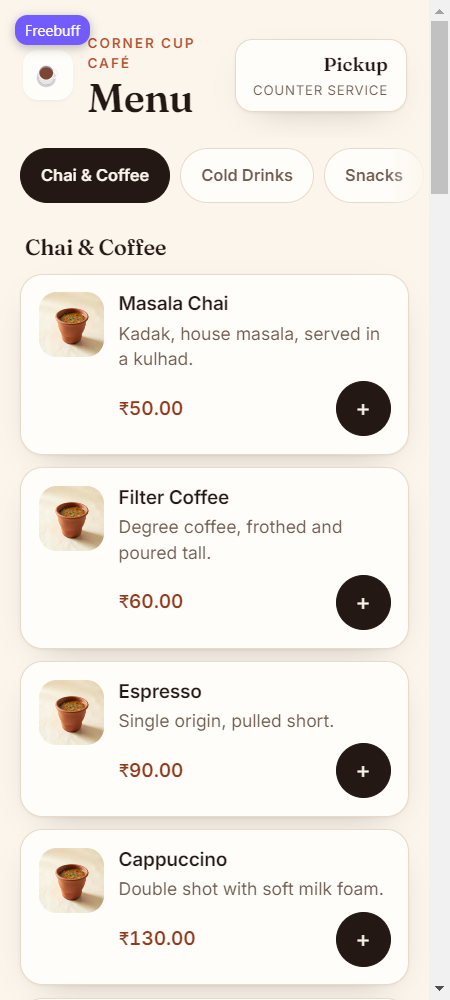
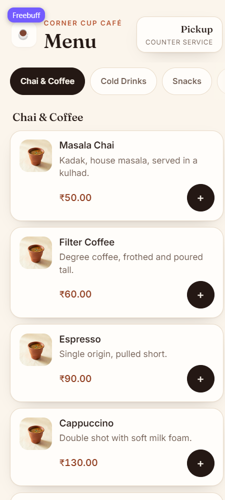
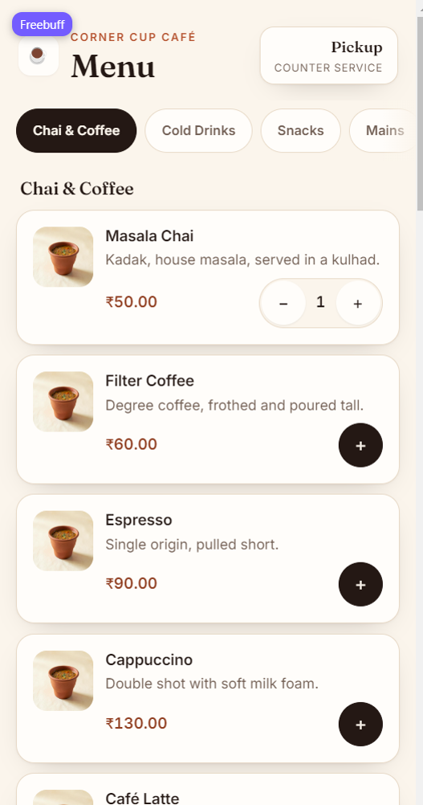
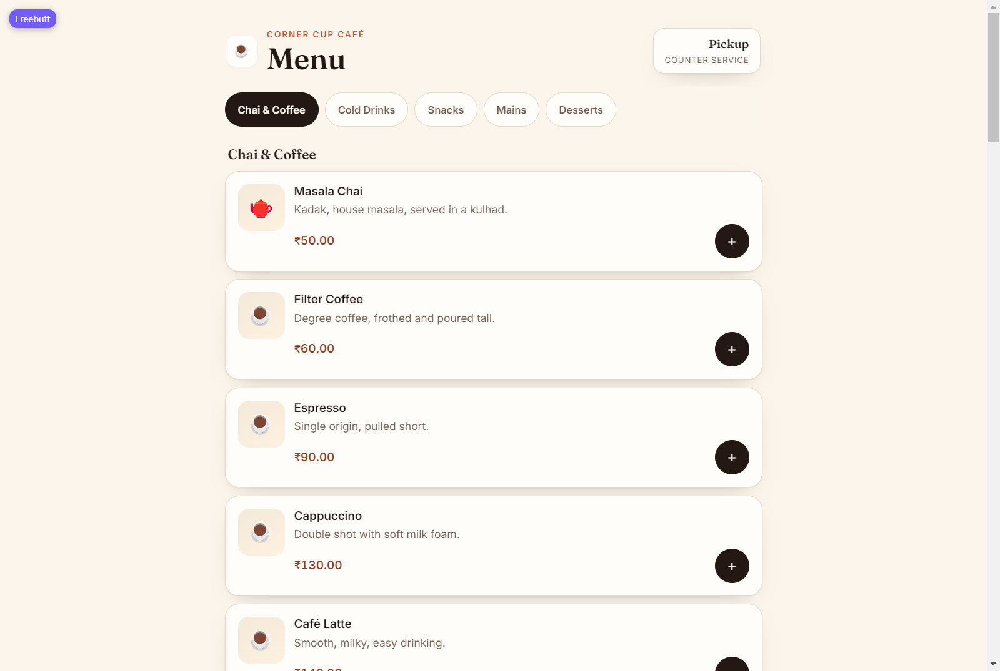
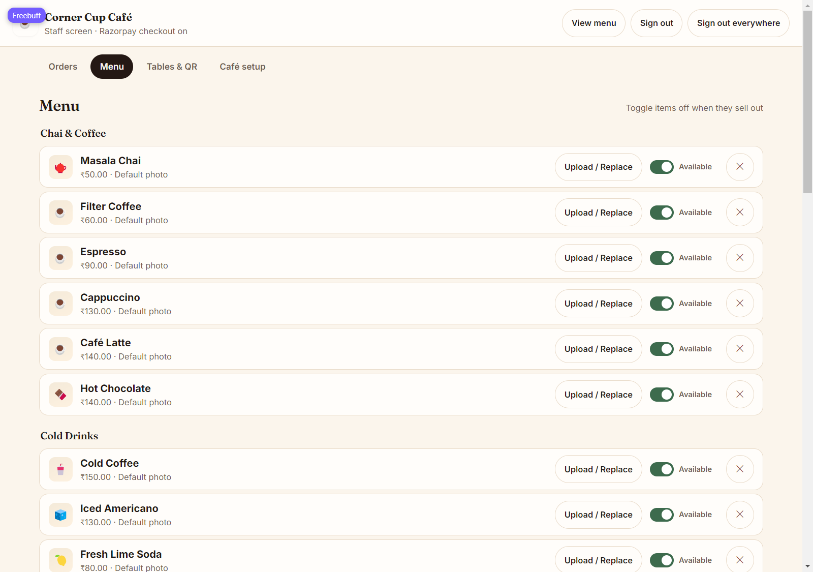
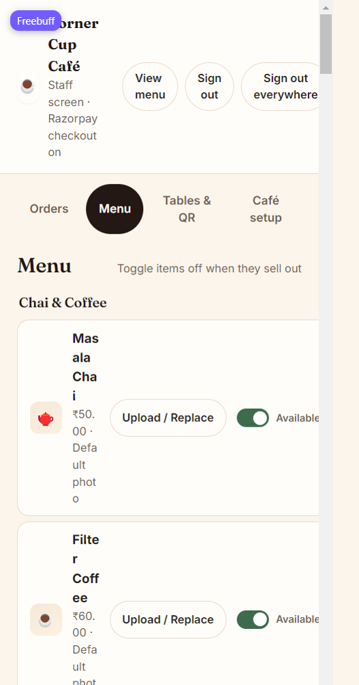
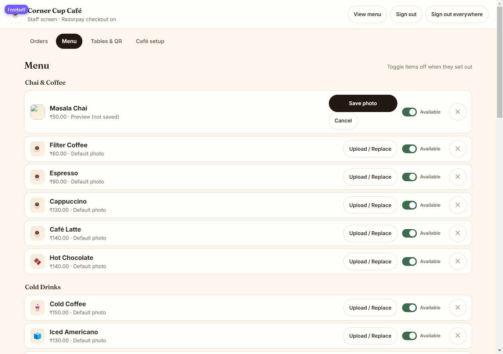

# Stage 3C — Menu Photography Local Review

**Type:** read-only visual and integration review of the Stage 3B work.
**Nothing was edited, committed, deployed, published, provisioned or migrated.** The only files written
are this report and the screenshots it references.

**Recommendation: CONDITIONAL GO for local testing** — the customer menu is good to test on a phone
today; the owner dashboard's photo controls need the two layout/accessibility fixes in §8 before a
shop-floor phone test would be meaningful, and the upload itself still cannot complete locally until the
`IMAGES` binding is provisioned.

---

## 1. Environment

| Item | Value |
| --- | --- |
| Worktree | `C:\Users\rahil\.freebuff\worktrees\0db48f77\e748e2077e11ff985d1d6206202b02a4f67b3351f6ea5b9c` |
| Stage 3B files present | `worker/db.js` (image columns), `worker/api.js` (image routes), `src/lib/menuImages.js`, `src/pages/Menu.jsx`, `src/pages/Admin.jsx`, `src/lib/api.js`, `public/defaults/*.jpg`, `tests/menu.images.test.mjs`, `tests/migrations.test.mjs` — all present, all still dirty/untracked exactly as left after Stage 3B |
| Pre-existing dev server | **still running** on `http://127.0.0.1:3000` (the server started in the previous session, bound `0.0.0.0:3000`). Serves the same source; its local D1 holds the earlier café (`slug: corner-cup-caf`, "Spice Hub"). |
| Review server (fresh) | `npx wrangler dev --ip 127.0.0.1 --port 3100 --persist-to .review-state --var OWNER_PASSWORD:… --var ADMIN_SECRET:…` — **isolated local persistence** (`.review-state/`), review-only credential values passed on the command line, never the project's `.dev.vars` values |
| Review URL | **`http://127.0.0.1:3100/c/corner-cup-cafe`** (menu) · `http://127.0.0.1:3100/c/corner-cup-cafe/owner` (board) |
| Reachability | `GET /` → 200, `GET /api/health` → `{"status":"ok","database":"ok"}`, `GET /api/cafe` → `{"slug":"corner-cup-cafe","name":"Corner Cup Café","serviceMode":"counter"}` |
| Data | fresh local D1 seeded with the 27-item starter menu; no custom photographs |
| Production/staging | not contacted at any point |
| Test harness | auth harness already running at `http://127.0.0.1:8790` (used by the suites, unchanged) |

Both servers are **still running** and were left untouched. `.review-state/` is throwaway local review
state created by `--persist-to`; it is not part of the app and no existing database was touched.

**Storage limitation (expected, recorded as such):** `wrangler.jsonc` has no `r2_buckets` entry, so the
upload route answers **503 `{"error":"Image storage is not configured."}`**. Confirmed from the browser
network log:

```
POST http://127.0.0.1:3100/api/cafes/corner-cup-cafe/admin/menu/1/image → 503 (Fetch)
```

This is an environment gap, **not** a successful upload and not a code defect.

---

## 2. Viewport-by-viewport observations (customer menu)

All measurements are from the live DOM at each width, not from the images alone.

### 360 × 800 (small Android / iPhone SE class)



- 27 items, **all 27 medallions show a photograph**; no item fell back to emoji.
- Medallion box **52 × 52 px**, `border-radius: 14px`, `object-fit: cover` — identical geometry to the
  pre-Stage-3B tile; the emoji tile is unchanged.
- Photographs are square sources (1024 × 1024) rendered into the square tile, so the crop is centred with
  no distortion.
- Category rail is horizontally scrollable (`scrollWidth > clientWidth`); "Snacks" is partly visible at
  the edge, which is the intended scroll affordance, not clipped content.
- `scrollWidth 343 === clientWidth 343` → **no horizontal page overflow**; 0 of 27 rows extend past the
  viewport; the add control is **44 × 44 px** and fully inside the card.
- Header: the eyebrow "CORNER CUP CAFÉ" wraps to two lines at this width and the "Pickup / Counter
  service" badge takes roughly a third of the row. Nothing overlaps or clips. Cosmetic only.
- Names, prices and descriptions stay aligned to the text column; only the description wraps to two lines.

### 390 × 844 (iPhone 12–15 class)



- Same as 360 with a little more breathing room: `scrollWidth 374 === clientWidth 374`, no overflow,
  all medallions 52 px, `cover`.
- Broken-image path exercised live: dispatching a real `error` event on the first medallion's ``
  replaced the tile with the item's emoji (`hasImg: false`, tile text `🫖`) within one frame. The fallback
  chain works and does not retry the failing URL.
- Interaction: the category chips, add buttons and stepper all respond; no layout shift when the cart bar
  appears.

### 430 × 932 (large phone / small tablet)



- `scrollWidth 414 === clientWidth 414`; 27 photographs, 0 emoji-only tiles, rail still scrollable.
- The quantity stepper appears in place of the "+" after adding, inside the same row height; no reflow of
  the photo or title.
- The header is 78 px tall and no longer wraps the eyebrow — the 360 px wrap is a width artefact only.

### 1280 × 860 (desktop)



- Content is centred in a max-width column; photographs render at 52 px, `cover`, radius 14 px.
- Cart bar and stepper work (`1 item in your order ₹50.00`).
- This screenshot was taken **after** the deliberate broken-image probe, so the whole "Chai & Coffee"
  category shows emoji tiles. That is the fallback working — see issue **M-1** for why one failure affects
  the whole category.

### Customer menu findings

| # | Finding | Severity |
| --- | --- | --- |
| C-1 | Category defaults render for every seeded item; the 52 px medallion, radius, spacing and card layout are unchanged from before photography | — (pass) |
| C-2 | `object-fit: cover` on a square tile: no distortion, centred crop, no letterboxing | — (pass) |
| C-3 | Name / description / price / controls stay aligned at 360, 390, 430 and desktop; no horizontal overflow at any width | — (pass) |
| C-4 | Broken image falls back to the category default, then to the emoji; the emoji tile keeps the same box and typography | — (pass) |
| C-5 | A single failed source suppresses that photo for **every item sharing it** until reload (the broken set is keyed by URL). On a flaky network one 404 for `coffee.jpg` turns all coffee items into emoji at once | **Low** (M-1) |
| C-6 | Custom-upload rendering (non-square photo into the square tile) could not be observed live because no upload can complete without storage; the crop rule is the same `object-fit: cover` asserted in the component | unverified visually |

---

## 3. Owner upload experience

### 1280 — Menu tab



- Each row: thumbnail (or emoji) · name · `₹price · Default photo` · **Upload / Replace** · Available
  toggle · delete. Every item is labelled "Default photo", which is correct for a menu with no uploads.
- The photo control reads clearly and is 44 px tall, matching the other row buttons.

### 390 — Menu tab (mobile)



This is the significant finding of the review — **the row layout collapses at phone widths**:

- Card right edge **456 px** against a **374 px** client width; all 27 rows overflow their container, and
  because the page's `scrollWidth === clientWidth` the overflow is clipped rather than scrollable.
- The text column is squeezed to **31 px**, so "Masala Chai" renders one or two characters per line
  ("Mas / ala / Cha / i"), the price wraps ("₹50. / 00"), and "Default photo" stacks vertically.
- The availability toggle is cut at the right edge ("Available" clipped), and the delete ✕ is pushed out
  of view entirely.
- Cause: the new photo column (137 px of controls) plus the switch and delete button were added to a
  non-wrapping flex row without allowing the text column to retain a minimum width or the row to wrap.

### Preview before save

- Selecting a file sets the tile to a `blob:` URL, changes the row label to **"Preview (not saved)"**, and
  swaps **Upload / Replace** for **Save photo** + **Cancel** — confirmed in the DOM and in the
  accessibility tree.
-  — the medallion in this capture shows a
  broken-image glyph. **That is an artefact of the automated injection, not an app defect:** files pushed
  into the picker through the review harness produce `blob:` URLs that this browser context cannot read
  (verified independently — a plain `new Image()` pointed at an object URL minted the same way also fails,
  and `fetch(blob:)` returns "Failed to fetch"). The photograph preview itself therefore remains
  **visually unverified**; the state transition, label and buttons are verified.
- **Cancel** clears the preview and restores "Default photo" and the Upload / Replace control (verified
  after clicking it).
- **Save photo** issues the real multipart POST. With no `IMAGES` binding it returns 503, and the UI shows
  the server message `Image storage is not configured.` in the alert line, leaving the preview in place so
  the owner can retry once storage exists. A loading state ("Saving…") exists but is too brief to capture
  against a local 503.
- **Remove photo** only renders for an item with `hasCustomImage`; with no storage it could not be shown
  or clicked in this environment. Its behaviour (restore default immediately, 200 with `imageUrl: null`,
  object deleted best-effort) is covered by the API tests.

### Keyboard and screen reader

- **The Upload / Replace control is not reachable by keyboard and is not exposed as a control.** The
  `<input type="file">` is rendered with `hidden` (`display: none`), and the surrounding `<label class="btn">`
  has `tabIndex -1` and no `role`. Measured tab order on the Menu tab:

  ```
  View menu → Sign out → Sign out everywhere → Orders → Menu → Tables & QR → Café setup
  → Available (toggle) → ✕ (delete) → Available → ✕ …
  ```

  The upload control is absent from that sequence. In the accessibility tree the row exposes
  `LabelText "Upload / Replace"` with no focusable element and no file input at all, so a screen reader
  user hears the words but has no way to activate them.
- **Save photo** and **Cancel** are real `<button>`s and *are* focusable and labelled once a preview
  exists — only the initial file selection is unreachable.
- The error paragraph has no `role="alert"` / `aria-live`, so a failed save is visible but not announced.

| # | Finding | Severity |
| --- | --- | --- |
| A-1 | Menu rows collapse below ~430 px: 31 px name column, wrapped price, clipped availability toggle, delete button off-screen, 27 rows wider than their container | **High** |
| A-2 | Upload / Replace cannot be reached by keyboard and is not exposed to assistive tech (hidden input, non-focusable label) | **High** |
| A-3 | Save errors are not announced (no live region) | **Medium** |
| A-4 | Error copy `Image storage is not configured.` is accurate but platform-flavoured for a café owner | **Low** |
| A-5 | Preview pixels unverified (automation blob limitation), removal UI unverified (needs storage) | informational |

---

## 4. Security review (implementation reading)

| Claim | Verdict | Evidence |
| --- | --- | --- |
| JPEG, PNG, WebP accepted; SVG rejected | **Yes** | `detectImageFormat` matches `FF D8 FF`, the 8-byte PNG signature, and `RIFF….WEBP`. Everything else → 415. A test posts a real SVG and asserts 415. |
| File size limit (1 MB) | **Yes** | `IMAGE_MAX_BYTES = 1 048 576`; checked on `Content-Length` before parsing, on `File.size`, and again on the buffer → 413. |
| Dimension and pixel-count limits | **Yes, header-based** | `IMAGE_MAX_DIMENSION = 4096`, `IMAGE_MAX_PIXELS = 16 MP`, read from PNG IHDR, JPEG SOF0/1/2, WebP VP8/VP8L/VP8X → 413. |
| MIME type from bytes, not the browser | **Yes** | Served type comes from `imageContentType(format)` derived from magic bytes; the uploaded `Blob` type is ignored; responses carry `X-Content-Type-Options: nosniff`. |
| Server-generated keys scoped to café + item | **Yes** | `cafes/<cafe.id>/menu/<id>/<crypto.randomUUID()>.<ext>`; both ids come from the resolved café and a D1 lookup, never from the request body. Keys are never returned to clients (only a URL). |
| Owner session + CSRF on mutations | **Yes** | Routes sit behind `ownerSession()`; both call `verifyCsrf(request, env, cookieName(cafe), ownerSessionIdOf)`, which requires a same-origin `Origin` and a live token bound to the session id. Tests assert 401 without a session, 403 without/with an unknown token, and 403 for a foreign Origin. |
| New object uploaded before the D1 update | **Yes** | `IMAGES.put(newKey, …)` then `UPDATE menu_items SET image_key = ?` — in that order. |
| Old object deleted only after the D1 commit | **Yes** | The `delete(previousKey)` call is after the update's `changes` check; a delete failure is logged and does not fail the request. |
| Failed D1 update rolls back the new object | **Yes** | Any throw or zero-row update triggers `delete(newKey)` before returning 502; a test injects a D1 write failure and asserts the old bytes are still served, then that the same replacement succeeds once the fault is removed. |
| Cache versioning changes on replace/remove | **Yes** | `imageUrl` carries `?v=<image_updated_at>`; a replacement writes a new timestamp and key (URL changed), a removal returns `imageUrl: null` so the default/emoji is used with no stale photo URL. Responses are `public, max-age=31536000, immutable`, which is safe only because the URL is versioned. |
| Cross-café access | **Blocked** | Every query is `id AND cafe_id`; a session minted for café A is refused under café B's cookie name (401), and B's item id under A's slug is 404. Tests cover both. |
| No bucket/credential disclosure, no image contents logged | **Yes** | Responses contain only ids, URL and booleans; error logs carry café id, item id, object key and message only. |

### Explicit limitation — this is not full image decoding

**Header/signature validation is not full image decoding.** The server checks magic bytes and parses
dimension fields out of the container headers; it never encodes or decodes pixels, because workerd has no
image decoder without Cloudflare Images/Image Resizing (a paid service, out of scope here). Consequences
that must not be overstated:

- **Decompression-bomb protection is not proven.** The dimension limits are read from headers a crafty
  client can lie about; a file can declare 800 × 600 and still carry an enormous IDAT/scan payload within
  the 1 MB object limit. Nothing server-side ever inflates it, so the *server* is safe, but the *guest's
  browser* downloads and decodes it. A proven guard would require actually decoding (or a safe
  re-encode) on upload, which this implementation does not do.
- A structurally valid header followed by arbitrary trailing bytes passes validation; they are stored and
  re-served verbatim as `image/png|jpeg|webp` with `nosniff`, so they cannot execute as HTML or script in
  the same origin, but they are not guaranteed to be a displayable photograph.
- The `x-content-type-options: nosniff` + byte-derived `Content-Type` + same-origin CSP (`img-src 'self'
  data:`) remain the containment for that residual risk.

---

## 5. Regression checks

Run from the worktree root, with the auth harness already up on `:8790`.

| Check | Command | Result |
| --- | --- | --- |
| Targeted menu-image + migration tests | `node --import ./tests/setup/register.mjs --test --test-concurrency=1 tests/migrations.test.mjs tests/menu.images.test.mjs` | **17 tests, 17 pass, 0 fail**, exit 0 |
| Full suite | `npm test` | **462 tests, 462 pass, 0 fail, 0 skipped**, exit 0 (~100 s) |
| Production build | `npm run build` | `vite v6.4.5`, 105 modules, `dist/assets/index-CnQn2jET.js 284.50 kB`, exit 0 |

**No failures occurred, so nothing was fixed and nothing needed fixing.** The full-suite and build logs are
in `.qa-logs/stage3c-full.log` and `.qa-logs/stage3c-build.log`.

---

## 6. Issues, classified

| ID | Issue | Severity | Where |
| --- | --- | --- | --- |
| **A-1** | Owner Menu rows collapse at phone widths: 31 px name column, wrapped prices, clipped availability toggle, delete button off-screen, every row wider than its container (456 vs 374 px at 390) | **Blocker for phone use of the owner board**, High overall | `src/pages/Admin.jsx` MenuTab row + `.admin-item` / `.admin-item-photo` styles |
| **A-2** | Upload / Replace is unreachable by keyboard and not exposed as a control (hidden input, non-focusable label, absent from tab order and accessibility tree) | **High** (WCAG 2.1.1) | admin file-pick markup |
| **A-3** | Upload/save errors are not announced to assistive tech (no `role="alert"`/live region) | Medium | admin alert line |
| **M-1** | One failed image URL suppresses that photo for every item sharing it until reload | Low | `src/lib/menuImages.js` + `Menu.jsx` broken set |
| **A-4** | Platform-flavoured error copy ("Image storage is not configured.") | Low | worker message surfaced by the UI |
| **E-1** | Uploads return 503 locally because no `IMAGES` binding exists | **Expected environment limitation**, not a defect | `wrangler.jsonc` (unchanged by design) |
| **U-1** | Preview pixels and the Remove control could not be observed live (automation blob limitation / needs storage) | informational | review coverage |

No Blocker-class security or data-integrity issue was found: the write ordering, rollback, CSRF gating,
tenant scoping and cache versioning all behave as designed and are covered by passing tests.

---

## 7. GO / CONDITIONAL GO / NO-GO

**CONDITIONAL GO — for local testing only.**

- **Customer menu: GO.** Photographs render in the 52 px medallions at 360, 390, 430 and desktop; cover
  cropping, alignment, fallbacks, cart/stepper interactions and page overflow are all correct. It can be
  tested on a phone now.
- **Owner dashboard: GO with conditions.** Upload/Replace, preview state, Save, Cancel, custom-vs-default
  labelling and error surfacing all work at desktop width. Before it is used on a phone:
  1. fix **A-1** (row layout below ~430 px) — this is the one that makes the board unusable on a handset;
  2. fix **A-2** (keyboard/AT access to the file picker);
  3. consider **A-3** and **A-4** while in that code.
- **End-to-end upload remains untestable locally** until an `IMAGES` R2 binding exists (**E-1**); the path
  is verified at API level against the harness's in-memory binding, and the 503 is handled gracefully by
  the UI.
- **Not a NO-GO:** nothing here blocks continued local work, and no evidence suggests data loss, tenant
  leakage or a security regression.

Still running, unchanged, for further testing: `http://127.0.0.1:3100/c/corner-cup-cafe` (isolated review
data) and the original `http://127.0.0.1:3000`.
