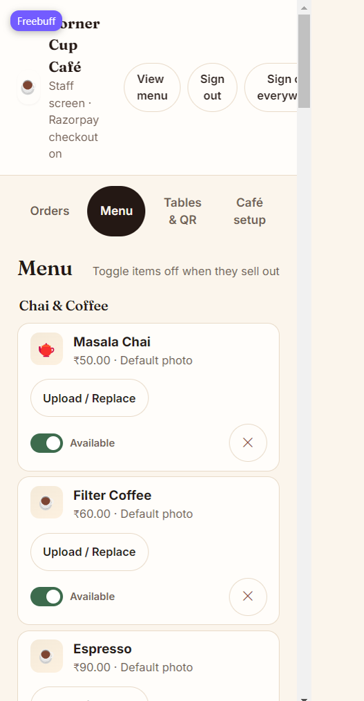
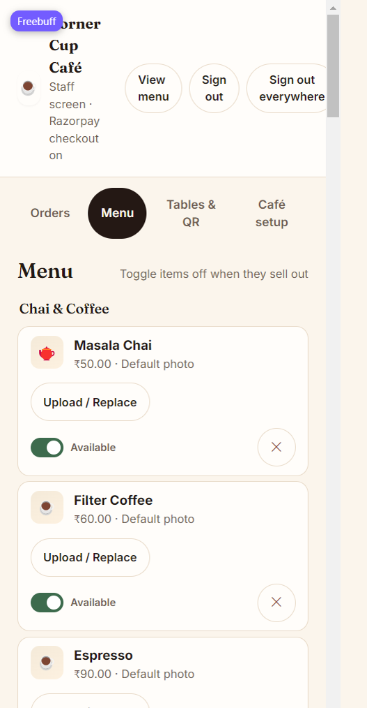
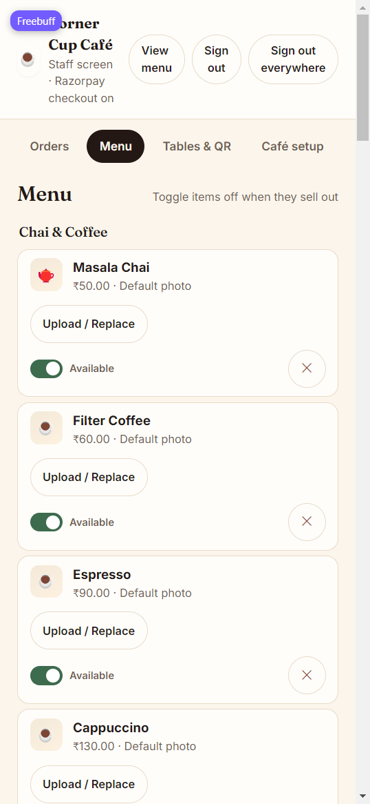
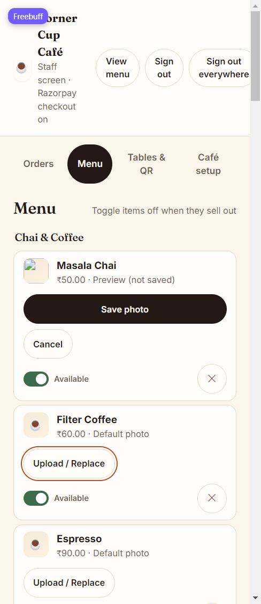
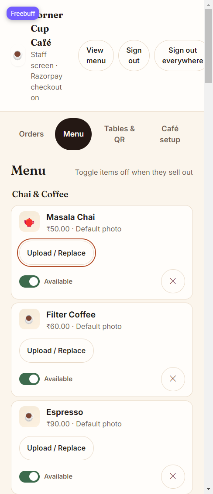

# Stage 3D — Owner Menu Mobile and Accessibility Fixes

**Scope:** the two findings in `STAGE3C_MENU_PHOTOGRAPHY_REVIEW.md` only — **A-1** (Menu rows overflowing
phone widths) and **A-2** (Upload/Replace unreachable by keyboard). No other behaviour was touched; no
Worker, API, validation or authentication code changed.

**Result:** both fixed and verified at 360, 375, 390, 430 and 1280 px. Full suite 467/467 pass, production
build green.

---

## 1. What changed

| File | Change |
| --- | --- |
| `src/pages/Admin.jsx` | Row controls are grouped into one `.admin-item-actions` block. The photo picker is now a real `<button>` that opens a per-row hidden file input held in a ref; the input is `hidden`, `tabindex="-1"` and `aria-hidden="true"` so the action is offered exactly once. Accessible names on Upload/Replace and Remove. One polite live region for the tab plus `role="alert"` on the error line. |
| `src/styles.css` | `.admin-item-photo` (wrapping flex row), `.admin-item-actions` (grouped, right-aligned), a `@media (max-width: 640px)` block that lets the row wrap and gives the controls their own line, and a `.sr-only` utility for the live region. |
| `tests/admin.menu.controls.test.mjs` | **New.** Five regression tests for A-1 and A-2. |
| `STAGE3D_MENU_MOBILE_ACCESSIBILITY_REPORT.md` | This report. |
| `screenshots/stage3d/*.png` | Before/after captures produced for this review. |

No change to `worker/*`, the image validation limits, CSRF, sessions, the customer menu or any other screen.

---

## 2. A-1 — Menu row overflow

### What was wrong

The photo controls were a bare `<div>` in the same non-wrapping flex row as the emoji, the name and the
availability/delete buttons. Adding the 137 px Upload/Replace button made every card wider than the
viewport: at 390 px the card measured **456 px against a 374 px client width**, the name column was
squeezed to **31 px** ("Mas / ala / Cha / i"), the price wrapped, "Available" was clipped and the delete ✕
sat off-screen. All 27 rows overflowed.

### What it is now

- The photograph, availability and delete controls share one `.admin-item-actions` group.
- Below 640 px the row wraps: name and price keep the first line at full width, the photograph control
  takes the second, and the availability toggle and delete button share the third (delete flush right).
- At 640 px and above nothing moves: the group is a single right-aligned row exactly as before.

### Before / after measurements

| Width | Before (Stage 3C) | After |
| --- | --- | --- |
| 360 | card 456 px, name ~31 px, rows past viewport: 27/27 | **card 303 px in a 343 px viewport**, name 89 px, rows past viewport **0**, page `scrollWidth == clientWidth`, all controls inside |
| 375 | same defect | **card 318 px in 358 px**, name 89 px, 0 rows past viewport, controls inside |
| 390 | card 456 px in 374 px; delete ✕ off-screen | **card 334 px in 374 px**, name 89 px (was 31), 0 rows past viewport, Upload 35–172, toggle 35–143, ✕ 264–308 — all inside |
| 430 | card 456 px in 414 px | **card 374 px in 414 px**, name 89 px, 0 rows past viewport, controls inside |
| 1280 | correct (one row) | **unchanged**: card 62–1202 px, row height **66 px** (same as before), Upload 874–1011, toggle 1023–1131, ✕ 1143–1187 on one line, no overflow |

At every width: `document.documentElement.scrollWidth === clientWidth` (no horizontal overflow) and every
row's right edge is inside the viewport.

### Screenshots

| 360 px | 390 px |
| --- | --- |
|  |  |

| 430 px | Preview state at 390 px |
| --- | --- |
|  |  |

The 375 px capture is in `screenshots/stage3d/admin-menu-375-after.png`.

In the preview state the row becomes: name + "Preview (not saved)", the full-width **Save photo** button,
**Cancel**, then the availability toggle and delete ✕ — every control still inside the card, no overflow.

**Desktop screenshot limitation:** the review browser panel would only capture ~520 px of width, so a true
1280 px capture comes back cropped on the right. Desktop is therefore evidenced by the DOM measurements
above (row height 66 px, all three controls on one line at 874–1187 px inside a 1202 px card) and by the
unchanged stylesheet above the 640 px breakpoint, not by a picture. The Stage 3C desktop capture
(`screenshots/stage3c/admin-menu-1280.png`) remains a valid visual reference: the desktop arrangement it
shows is the arrangement these measurements describe.

---

## 3. A-2 — Upload keyboard accessibility

### What was wrong

The control was `<label class="btn">Upload / Replace<input type="file" hidden></label>`. A `hidden` input is
`display: none`, so it never entered the tab order or the accessibility tree; the label carried no
`tabindex`, no `role` and no association. Measured tab order jumped straight from the tab bar to the
availability toggles, and a screen reader was read the words "Upload / Replace" with nothing to activate.

### What it is now

- The visible control is a **real `<button type="button">`** with the accessible name
  `Upload photo for <item>` (or `Replace photo for <item>` once a custom photo exists), and
  `Remove photo from <item>` on the removal button.
- It opens the row's file input, which stays `hidden`, `tabindex="-1"`, `aria-hidden="true"` — one
  actionable control, not two.
- Focus indication is the app's existing `.btn:focus-visible` rule (2 px accent outline, 3 px offset),
  which the button now inherits by being a `.btn`. Verified live: `:focus-visible` matched and
  computed `outline: solid` with a 3 px offset.
- **Save photo** and **Cancel** were already real buttons; they remain so and are reachable once a preview
  exists. **Remove photo** is a real button with an explicit label.
- Announcements: one `.sr-only` `role="status" aria-live="polite"` region reports the outcome of the row
  you acted on, and the error line is now `role="alert"`.

### Keyboard traversal (real Tab presses in Chromium)

Starting from the Menu tab:

```
Menu → Tables & QR → Café setup → [row 1] Upload / Replace → Available → ✕
     → [row 2] Upload / Replace → …
```

The focused control reports `aria-label="Upload photo for Masala Chai"` and `:focus-visible = true`.



### Announced text (captured live)

| Action | Live region |
| --- | --- |
| File chosen | `Photo ready to save for Masala Chai. Choose Save photo to keep it, or Cancel.` |
| Cancel | `Preview cancelled for Masala Chai. The current photo is unchanged.` |
| Save succeeded | `Photo saved for Masala Chai.` |
| Save failed | `We couldn't save the photo for Masala Chai. Image storage is not configured.` + `role="alert"` line |
| Remove succeeded | `Custom photo removed from Filter Coffee. The category default is back.` |

The failure path above is the real local 503 (no `IMAGES` binding); it is still recorded as an expected
environment limitation, not a successful upload.

---

## 4. Regression tests added — `tests/admin.menu.controls.test.mjs`

Bundles the real `Admin.jsx` with esbuild into jsdom, mocks only `fetch`, and drives the actual Menu tab.

| Test | Guards |
| --- | --- |
| A-2: the photo picker is a real button and the file input stays out of the tab order | Button exists with the right accessible name; input is `hidden` + `tabindex="-1"` + `aria-hidden`; the old `label.file-pick` is gone; pressing the button opens the picker |
| A-2: picking a photo previews it, Cancel restores the default, and the change is announced | Preview status, Save/Cancel presence, live-region text, Cancel restore |
| A-2: Save photo posts multipart with the CSRF token and announces the result | URL, `POST`, `x-csrf-token`, `FormData` body, success announcement |
| A-2: Remove photo deletes with the CSRF token and announces the default is back | `DELETE` + token + label + announcement |
| A-1: row controls are grouped so a narrow screen can wrap them, and the stylesheet does | `.admin-item-actions` contains photo/toggle/delete; no inline width on the name column; `.admin-item-photo` may wrap; the 640 px breakpoint sets `flex-wrap: wrap` on the row and `flex: 1 1 100%` on the actions |

jsdom has no layout engine, so A-1's pixel behaviour is asserted by the live browser measurements in §2 plus
these structural guards; A-2 is asserted end to end.

---

## 5. Test and build results

| Check | Command | Result |
| --- | --- | --- |
| New regressions + image tests | `node --import ./tests/setup/register.mjs --test --test-concurrency=1 tests/admin.menu.controls.test.mjs tests/menu.images.test.mjs` | **17 tests, 17 pass, 0 fail** |
| Full suite | `npm test` | **467 tests, 467 pass, 0 fail, 0 skipped**, exit 0 |
| Production build | `npm run build` | `vite v6.4.5`, `dist/assets/index-B_nBG-g5.css 33.10 kB`, `index-xOE_EXmo.js 285.40 kB`, exit 0 |

Logs: `.qa-logs/stage3d-full.log`, `.qa-logs/stage3d-build.log`.

---

## 6. Known limitations / notes

- **Desktop capture** is cropped by the review browser panel's width; desktop evidence is measurement-based
  (§2). No layout rule changed above 640 px, and the measured row height (66 px) matches the pre-fix value.
- **Preview thumbnail** in the captures shows a broken-image glyph: files injected into the picker by the
  review harness carry blob URLs the page context cannot read (independently reproduced with a plain
  ``). The preview *state*, labels, buttons and announcements are real; the pixels are an automation
  artefact.
- **Admin header at 360 px** (wrapped café name, "Sign out everywhere" clipped) is pre-existing and outside
  A-1/A-2; it was left untouched.
- **Image validation and authentication were not modified.** Header/signature validation remains exactly as
  reviewed in Stage 3C and is still not full image decoding; nothing in this stage claims otherwise.
- The review server on `http://127.0.0.1:3100` and the original dev server on `http://127.0.0.1:3000` are
  both still running.

---

## 7. Boundaries respected

- Only the two reported issues were addressed; no unrelated refactor, styling or feature work.
- No commit, push, deploy or publication; nothing provisioned; no binding, secret or database changed.
- Production and staging were never contacted.
- All pre-existing worktree changes were preserved as they were.
