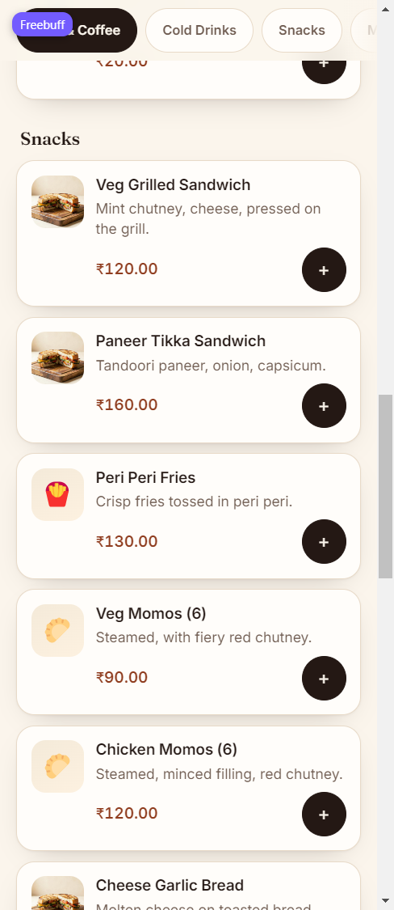
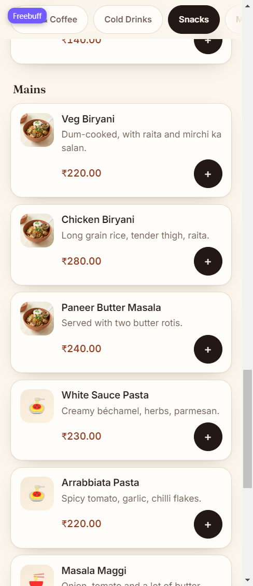

# Stage 3F — Item-Specific Default Image Mapping

**Status:** implemented and verified locally. Nothing deployed, committed or provisioned; no image was
generated, downloaded or replaced; no migration, D1 change, binding or seed-data change.

**Result:** the approved Stage 3E table is live. The guest menu now shows **17 photographs and 10 emoji**
across the 27 seeded items instead of 27 copies of five category pictures, and the misleading `dish.jpg`
catch-all is gone.

---

## 1. What changed

| File | Change |
| --- | --- |
| `src/lib/menuImages.js` | Added the static `ITEM_DEFAULTS` table (27 entries keyed `Category|Item`), a normaliser, and normalized lookup maps built once at module load. `null` is an explicit "use the emoji" sentinel; a missing key means "no item-specific default". Removed `FALLBACK_IMAGE` / the universal `dish.jpg`. Resolution now walks upload → item default → category default → emoji. |
| `tests/menu.defaults.test.mjs` | **New.** Eight tests covering the whole mapping. |
| `tests/menu.images.test.mjs` | Ladder test updated: an unknown category now resolves to `null` (emoji) rather than `dish.jpg`. |
| `STAGE3F_DEFAULT_IMAGE_MAPPING_REPORT.md` | This report. |
| `screenshots/stage3f/*.png` | Captures of the live menu. |

`Menu.jsx`, the 52 px medallion, `object-fit: cover`, `alt={item.name}`, lazy loading and the broken-image
handler were **not touched** — only the data behind `resolveItemImage`.

### Resolution order (unchanged priority for uploads)

```
owner upload (item.imageUrl from D1)        ← highest priority, server-side truth
  → item-specific default (ITEM_DEFAULTS)
        null  → emoji, deliberately, with no category fall-through
  → category default (only when no item entry exists)
  → emoji
  → on  error: same ladder with the failed source marked broken → emoji
```

An unknown category resolves to no photograph at all. There is no substitute image anywhere in the ladder.

---

## 2. The mapping

| # | Category | Item | Resolves to | Source of decision |
| --- | --- | --- | --- | --- |
| 1 | Chai & Coffee | Masala Chai | `/defaults/coffee.jpg` | item |
| 2 | Chai & Coffee | Filter Coffee | `/defaults/coffee.jpg` | item |
| 3 | Chai & Coffee | Espresso | `/defaults/coffee.jpg` | item |
| 4 | Chai & Coffee | Cappuccino | `/defaults/coffee.jpg` | item |
| 5 | Chai & Coffee | Café Latte | `/defaults/coffee.jpg` | item |
| 6 | Chai & Coffee | Hot Chocolate | `/defaults/coffee.jpg` | item |
| 7 | Cold Drinks | Cold Coffee | `/defaults/cold-drink.jpg` | item |
| 8 | Cold Drinks | Iced Americano | `/defaults/cold-drink.jpg` | item |
| 9 | Cold Drinks | Fresh Lime Soda | **emoji 🍋** | explicit `null` |
| 10 | Cold Drinks | Blue Lagoon Mocktail | **emoji 🍹** | explicit `null` |
| 11 | Cold Drinks | Buttermilk | **emoji 🥛** | explicit `null` |
| 12 | Cold Drinks | Mineral Water | **emoji 💧** | explicit `null` |
| 13 | Snacks | Veg Grilled Sandwich | `/defaults/snack.jpg` | item |
| 14 | Snacks | Paneer Tikka Sandwich | `/defaults/snack.jpg` | item |
| 15 | Snacks | Peri Peri Fries | **emoji 🍟** | explicit `null` |
| 16 | Snacks | Veg Momos (6) | **emoji 🥟** | explicit `null` |
| 17 | Snacks | Chicken Momos (6) | **emoji 🥟** | explicit `null` |
| 18 | Snacks | Cheese Garlic Bread | `/defaults/snack.jpg` | item |
| 19 | Mains | Veg Biryani | `/defaults/main.jpg` | item |
| 20 | Mains | Chicken Biryani | `/defaults/main.jpg` | item |
| 21 | Mains | Paneer Butter Masala | `/defaults/main.jpg` | item |
| 22 | Mains | White Sauce Pasta | **emoji 🍝** | explicit `null` |
| 23 | Mains | Arrabbiata Pasta | **emoji 🍝** | explicit `null` |
| 24 | Mains | Masala Maggi | **emoji 🍜** | explicit `null` |
| 25 | Desserts | Chocolate Brownie | `/defaults/dessert.jpg` | item |
| 26 | Desserts | Choco Lava Cake | `/defaults/dessert.jpg` | item |
| 27 | Desserts | Brownie with Ice Cream | `/defaults/dessert.jpg` | item |

Distribution: coffee 6 · cold-drink 2 · snack 3 · main 3 · dessert 3 · **emoji 10** — five photographs, as the
audit predicted, but no item now shows a drink or dish it is not.

`public/defaults/dish.jpg` is left on disk untouched but is **no longer referenced by any code path**.

---

## 3. Live verification (local, 390 px)

Reloaded `http://127.0.0.1:3100/c/corner-cup-cafe/menu` against the rebuilt bundle and measured the DOM:

| Check | Result |
| --- | --- |
| Items | 27 |
| Photographs rendered | **17** |
| Emoji tiles | **10** — Lime Soda 🍋, Blue Lagoon 🍹, Buttermilk 🥛, Mineral Water 💧, Fries 🍟, both Momos 🥟, both pastas 🍝, Maggi 🍜 |
| Distinct sources | 5 (coffee, cold-drink, snack, main, dessert) |
| Medallion widths | `[52]` — every tile still 52 px, `object-fit: cover`, radius 14 px |
| Page overflow | none (`scrollWidth === clientWidth`) |





**Broken-image fallback, exercised live:** dispatching an `error` on the first biryani `` removed it and
drew 🍚 in the same 52 px tile within a frame. Because the broken set is keyed by source URL, the shared
`main.jpg` failing also moved its siblings to their emoji — that is the pre-Stage-3F behaviour of the
existing broken-image set, preserved rather than changed.

---

## 4. Tests added

`tests/menu.defaults.test.mjs` (8 tests, no DOM, no network):

| Test | Covers |
| --- | --- |
| all 27 seeded items resolve to their approved photograph or emoji | the whole table, driven from `SEED_MENU` so a renamed or added seed item fails loudly |
| every seeded item carries exactly one item-specific entry | 27 keys, no orphan entries, no item left to a category photo by accident |
| the ten emoji sentinels stop at the emoji instead of borrowing the category photograph | explicit `null` semantics — and that the category *does* have a photo, proving no fall-through |
| a category photograph is used only when no item-specific entry exists | new item in a known category → category photo; unknown category → none |
| an unknown or renamed item never falls back to the misleading dish photograph | no `dish.jpg` anywhere in either table, none resolvable |
| matching ignores case, spacing, punctuation and accents without losing the item | `"  MASALA   CHAI "`, `"Cafe Latte"`, `"VEG MOMOS (6)"` |
| an owner upload outranks the item default, and a broken upload falls back to it | upload wins for mapped and emoji items; broken upload advances to the item default |
| a broken default falls through the ladder and finally to the emoji | item default broken, category image broken, empty broken set |

The Stage 3B ladder test in `tests/menu.images.test.mjs` was updated for the removed universal fallback.

---

## 5. Results

| Check | Command | Result |
| --- | --- | --- |
| Targeted | `node --import ./tests/setup/register.mjs --test --test-concurrency=1 tests/menu.defaults.test.mjs tests/menu.images.test.mjs tests/admin.menu.controls.test.mjs` | **25 tests, 25 pass, 0 fail** |
| Full suite | `npm test` | **475 tests, 475 pass, 0 fail, 0 skipped**, exit 0 |
| Production build | `npm run build` | `vite v6.4.5`, `index-CIYopyjw.js 287.11 kB`, exit 0 |

Logs: `.qa-logs/stage3f-full.log`, `.qa-logs/stage3f-build.log`.

---

## 6. Notes

- **Owner uploads keep absolute priority.** `item.imageUrl` from D1 is checked before any default, for both
  photographed and emoji items; a broken upload still advances to the item default rather than jumping
  straight to the emoji.
- **Seed data untouched.** The table matches `SEED_MENU` by name at runtime; no menu row, price, emoji or
  sort order was modified, and no migration was added.
- **Renaming an item** (by the café, in the admin tab) keeps its photograph as long as the name normalises
  to the same key; otherwise it falls back to the category photograph, never to `dish.jpg`.
- **The 52 px medallion, cropping, alt text and lazy loading** are unchanged; only which `src` is chosen.

## 7. Boundaries respected

No images generated, downloaded or replaced; no R2 provisioning or binding change; no database migration or
seed change; no production/staging access; no deployment, commit or push; all pre-existing worktree changes
preserved. Only `src/lib/menuImages.js`, the two menu test files, this report and the screenshots under
`screenshots/stage3f/` were written.
