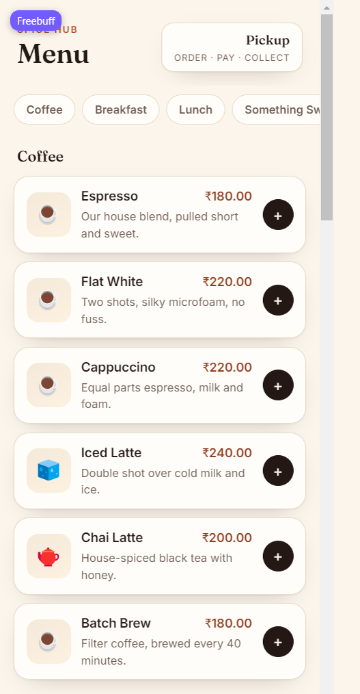
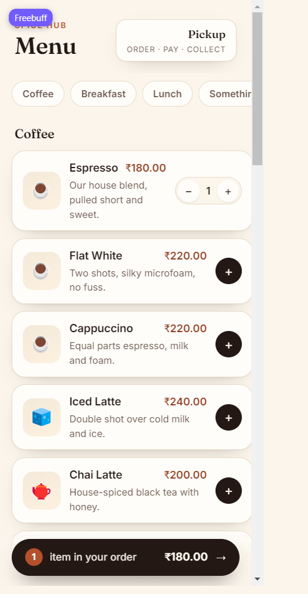
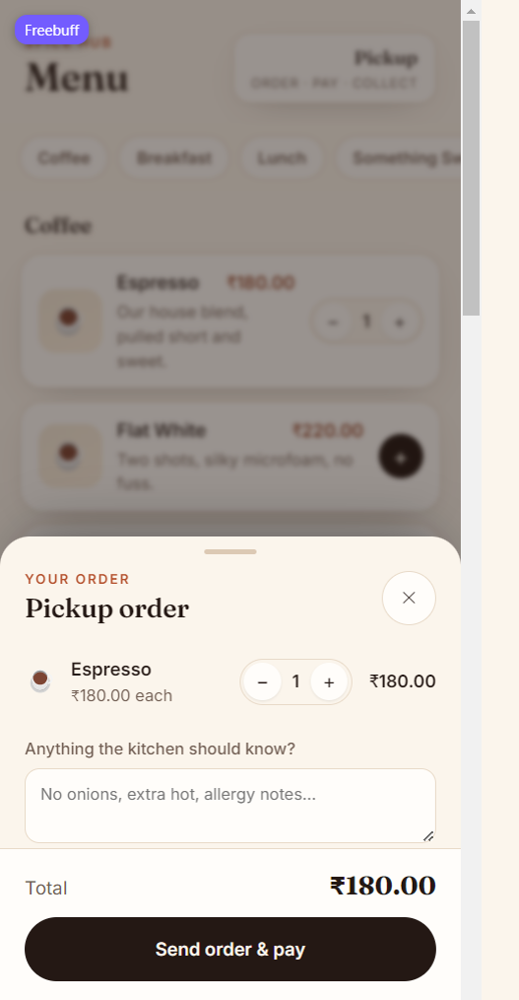
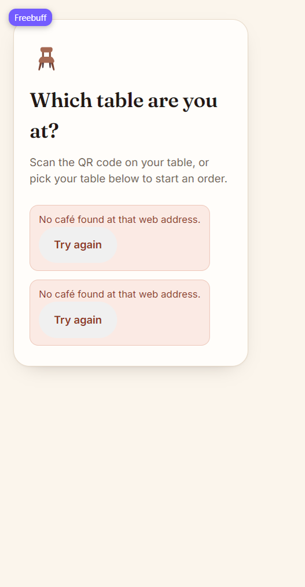

# Corner Cup — UI Improvement Stage 1: Customer Experience Audit

**Status:** read-only audit. No source file was modified, no backend, schema, payment, routing or order logic was touched, nothing was staged, committed or deployed.

**How this was produced:** source inspection of `src/` plus a locally served build (`wrangler dev` on `127.0.0.1:3000`, local dev D1 only) rendered at 360×800 and 390×844. Measurements below are taken from the live DOM, not estimated.

---

## 1. Existing design identity and colour palette

The product already has a coherent, deliberate identity. Everything proposed later preserves it.

### Palette (defined once in `src/styles.css` `:root`)

| Token | Value | Role |
|---|---|---|
| `--cream` | `#fbf5ec` | page background |
| `--cream-2` | `#f4ead9` | recessed surfaces, skeletons |
| `--white` | `#fffdfa` | cards |
| `--ink` | `#241814` | primary text, primary buttons, cart bar |
| `--ink-soft` | `#6f5c51` | secondary text (5.83:1 on cream ✓) |
| `--line` | `#e8dac8` | borders |
| `--accent` | `#b4502c` | eyebrow text, counts (4.70:1 on cream ✓) |
| `--accent-dark` | `#8f3c1e` | prices |
| `--sage` / `--sage-soft` | `#3d6b4d` / `#e7f0e7` | done steps, paid state |
| `--amber` | `#bf8526` | kitchen-note rule |
| `--radius` | `18px` | card corner |
| `--shadow` | `0 1px 2px …, 0 10px 30px -18px …` | soft paper lift |

Accent colours are used for state (paid/sage, due/terracotta, pending/amber) and are never used decoratively — worth keeping that discipline.

### Typography

- **Display:** Fraunces 400–700 (self-hosted woff2), used for `h1`–`h3`, prices in receipt totals, stat numbers, table numbers.
- **Body:** Inter 400–700 (self-hosted woff2).
- Scale in use: `h1` 1.75rem (2rem on menu, 2.4rem landing), `h2` 1.2rem, `h3` 1rem, body **15px**, `.small` **0.82rem (13.1px)**, `.eyebrow` **0.68rem (10.9px)**.
- No logo asset exists: the brand mark is the ☕ glyph inside a white rounded square (`.brand-mark` 56px / `.brand-mark.small` 40px). Favicon is the same glyph as an inline SVG.

### Design language

Paper-and-ink café feel: cream ground, warm brown ink, terracotta accent, serif display over sans body, pill buttons, soft 18–22px radii, restrained shadows, emoji medallions instead of photography, bottom-sheet cart, centred single column on every breakpoint (no desktop multi-column product grid by design).

### Identity inconsistencies found

| # | Issue | Evidence |
|---|---|---|
| I-1 | Three near-identical browns in use | `--ink #241814`, `index.html` `theme-color #231713`, Razorpay `theme.color #231713` |
| I-2 | Mobile browser chrome is dark while the app is cream | `theme-color #231713` vs `--cream #fbf5ec` |
| I-3 | Landing has a brand bar; the menu (the screen people spend time on) has none | `Landing.jsx` `.landing-bar` vs `Menu.jsx` `.menu-head` |
| I-4 | The same selectors are redefined up to four times in one file | `.landing-note` ×4, `.site-foot-links a` ×3, `.landing` ×2, `.table-chip` ×2 (lines ~120 and ~2087+) |

---

## 2. Page-by-page UI problems

### 2.1 Café menu — `/c/:slug/menu` and `/c/:slug/t/:tableNo`

| # | Problem | Detail |
|---|---|---|
| M-1 | **Category nav has no active state at all** | Buttons are rendered with no `active` class and no `aria-current` (`Menu.jsx`); there is no scroll-spy, so a guest never knows which section they are in. |
| M-2 | **Category chips are below the touch minimum** | Measured 35px tall (`Coffee`, `Breakfast`, …) against the 44px guideline. |
| M-3 | **Add and stepper controls are below the touch minimum** | `.add-btn` 36×36; `.stepper button` **30×30** (measured). The most-tapped control in the product is the smallest. |
| M-4 | **The horizontal nav gives no hint it scrolls** | At 390px "Something Sweet" is cut mid-word with no fade, no peek, no scrollbar (`.category-nav` hides it). |
| M-5 | **Card layout collapses on a 360px phone** | Name and price share one baseline row (`justify-content: space-between`), while the stepper occupies the right column: descriptions wrap to three lines (measured 13.12px text), card heights become ragged, and the price sits mid-card rather than anchoring the row. |
| M-6 | **Body copy is too small for a phone** | Item descriptions render at **13.12px**; `.small` is 0.82rem; the eyebrow is **10.88px**. |
| M-7 | **No café identity or way back on the menu screen** | The café name is a 10.9px uppercase eyebrow; the heading is the generic word "Menu"; there is no brand mark and no link back to `/c/:slug`. |
| M-8 | **Status chip carries marketing copy** | `.table-badge` shows "Pickup" over "order · pay · collect" — a 58px-tall block competing with the `h1`. In table mode it would read "Table 7 / scan · order · relax". |
| M-9 | **Sold-out dims the whole card to 62%** | `.menu-item.sold-out { opacity: .62 }` washes out the name and price too, reducing legibility instead of communicating state. |
| M-10 | **Emoji medallions read as placeholders, not product art** | 52px flat-gradient tiles; glyph appearance is OS-dependent (the Iced Latte renders as a blue ice cube on Windows). No image field exists (`/api/menu` returns `emoji`, no URL), so photography is a data-model change, not a styling one. |
| M-11 | **Skeleton does not cover the nav** | `SkeletonMenu` renders sections only; when data lands the category nav appears and pushes content down (visible layout shift). |
| M-12 | **Sticky offset is approximate** | `.menu-section { scroll-margin-top: 64px }` against a 55px nav plus padding; scrolled-to headings sit close to the pills. |
| M-13 | **Dead space when the cart is empty** | `.menu-page` always reserves `padding-bottom: 128px`, even with no cart bar. |

### 2.2 Table ordering — `/c/:slug/t/:tableNo`

Routing is correct and the table is remembered per café. Visual/behavioural gaps:

| # | Problem | Detail |
|---|---|---|
| T-1 | Table label is duplicated in three sizes | `h1` "Menu", `.table-badge` "Table 7", and the same label again in the sheet header. |
| T-2 | Table picker is visually a form, not a choice | `.table-chip` inside `.state-card` uses the same chip style as the landing page but at 110px minimum inside a narrow card — the two implementations have drifted (flex vs grid). |
| T-3 | **Unknown café produces a broken screen** | `/c/no-such-cafe/menu` renders the *table picker* ("Which table are you at?") with **two identical error alerts and two "Try again" buttons** — one from `/api/tables`, one from `/api/config`. See `ui-audit/05-error-state-360.png`. |

### 2.3 Product details and customisation

**There is no product detail screen and there is no option/modifier system.** A menu item carries `name`, `description`, `priceCents`, `emoji`, `available` only; the API exposes no options, sizes, milk choices or per-item notes. Customisation is the single free-text "Anything the kitchen should know?" field in the cart sheet.

This is an audit finding, not a defect: adding details pages or modifiers would require backend and schema work, which is out of bounds for this stage. Recommendation is to make the existing card communicate more (bigger name, roomier description, clearer price) rather than to invent a detail route.

### 2.4 Cart and checkout

| # | Problem | Detail |
|---|---|---|
| C-1 | **Money appears twice on every line** | "₹180.00 each" under the name and "₹180.00" as the line total, at 58px reserved width. |
| C-2 | **Stepper targets are 30px** inside the sheet as well | Same `.stepper` component; coin-sized buttons for an in-sheet adjustment. |
| C-3 | **The reassurance copy is the first thing a keyboard hides** | `.sheet-foot` stacks total → CTA → helper text, and the sheet is capped at `90vh`; with the iOS keyboard open the helper text and part of the CTA are behind it. |
| C-4 | **Escape does not close the sheet, and focus is not contained** | `CartSheet.jsx` has `aria-modal` and `role="dialog"` but no `keydown` handler, no focus trap, no initial focus. |
| C-5 | Close control is 34px (`.icon-btn`) | Below the touch minimum, top-right, reachable-but-small. |
| C-6 | No "add more items" path from inside the sheet | A guest must close the sheet to keep browsing; there is no secondary action. |
| C-7 | Cart bar packs four elements at 360px | count badge (24px) + "item in your order" + total + arrow, in one pill; workable but tight, and the total is not tabular-aligned. |
| C-8 | Note field is fixed at 2 rows | No autosize; a long allergy note scrolls inside a 2-row box. |

### 2.5 Order tracking — `/c/:slug/t/:tableId/order/:orderId`

Reviewed from source; **no screenshot** — the page requires a live order tracking token in the URL fragment, and minting one would mean writing an order, which is outside this read-only stage.

| # | Problem | Detail |
|---|---|---|
| O-1 | **The heading lies once the order progresses** | `h1` is hardcoded "Order confirmed" for every non-cancelled state; a served or cancelled-in-kitchen order still reads "Order confirmed". |
| O-2 | **The pickup/queue number is the smallest text on the page** | `Pickup #12` is a 10.88px uppercase eyebrow; it is the one piece of information a guest at the counter needs to read across a room. |
| O-3 | Loading state is a bare line of text | `"Finding your order…"` in a `state-card`; other screens get skeletons. |
| O-4 | Errors surface raw API strings | `error.message` printed verbatim in the card. |
| O-5 | Timeline connector is inconsistent | `::before` only colours for `done`, and the last step has no connector; the active step gets a halo but no motion. |
| O-6 | The only recovery control is a 13px underlined link | "Refresh status" (`.link-btn`) inside the Razorpay waiting card. |

### 2.6 Loading, empty and error states

| # | Problem | Detail |
|---|---|---|
| S-1 | Duplicate, contradictory error surfaces | Two identical alerts + two "Try again" buttons on one screen (see T-3). |
| S-2 | Skeletons exist on two screens only | Menu (`SkeletonMenu`) and landing table chips. Status page, payment panel and cart have none. |
| S-3 | Skeleton is not shaped like the result | Menu skeleton has no category nav and no price/stepper column, so the swap shifts layout. |
| S-4 | Empty menu has no copy | A café with zero available items renders headers with empty lists and no explanation. |
| S-5 | Retry button inside `.alert` is unstyled-primary | `.btn` without `.primary` inside a pink alert reads as a disabled chip; it is the only action in the box. |
| S-6 | Error card typography is display-sized for a failure | `h1` 1.75rem next to a 13px explanation, with the emoji at 34px — the loudest element is the icon. |

---

## 3. Mobile usability problems

Measured at 390×844 and 360×800 on the real build.

| # | Problem | Measurement |
|---|---|---|
| L-1 | **28 interactive targets under 44px on the menu screen alone** | category chips 35px; add buttons 36px; stepper buttons 30px; sheet close 34px |
| L-2 | No horizontal page overflow | ✓ `documentElement.scrollWidth` 374 @390, 343 @360 — the baseline is sound and must be preserved |
| L-3 | Scrolling category nav with no affordance | `.category-nav` `scrollWidth > clientWidth` = true, scrollbar hidden |
| L-4 | Description and eyebrow text below comfortable reading size | 13.12px and 10.88px |
| L-5 | Primary ordering actions are reachable | ✓ cart bar fixed above `env(safe-area-inset-bottom)`; CTA 52px on landing |
| L-6 | Sheet CTA at risk from the on-screen keyboard | `max-height: 90vh` + stacked footer; no `dvh`, no visual-viewport handling |
| L-7 | Missing focus-visible styles outside four selectors | only `.btn`, `.table-chip`, `.link-btn`, `.site-foot-links a` have it; add/stepper/nav/icon-btn do not |
| L-8 | Footer links wrap 4 + 2 with uneven rhythm | `.site-foot-links` gap `6px 16px`, 44px hit areas → second row of two |
| L-9 | Long café names truncate without a tooltip | `.landing-bar-name` ellipsis, `min-width: 0` (correct, but no title/aria fallback) |

Reduced motion is already honoured globally (`prefers-reduced-motion`), and `body.sheet-open` correctly locks background scroll — both should be kept.

---

## 4. Inconsistent components and styles

| # | Inconsistency | Where |
|---|---|---|
| D-1 | Two implementations of the table chip | base `.table-chip` (grid, hover lift) vs the 2087+ block (flex, active state, no lift) |
| D-2 | Three button hierarchies coexist | `.btn.primary` (ink, full width), `.btn.ghost`, and bare `.btn` inside alerts (looks disabled) |
| D-3 | Two "page shell" paddings | `.menu-page` 22/16/128 vs `.page-narrow` 26/18/60 vs `.landing` 14/16 |
| D-4 | Two card systems | `.state-card` (22px radius, 28px pad) vs `.landing-card` (20px radius, 16px pad) vs `.receipt`/`.pay-card` (20–22px) |
| D-5 | Heading sizes vary by page for the same level | `h1` 2.4rem landing, 2rem menu, 1.75rem default |
| D-6 | Money formatting is consistent (✓ `money()`), but alignment is not | prices not `font-variant-numeric: tabular-nums` anywhere |
| D-7 | Eyebrow used for three different jobs | section label, café name, pickup number |
| D-8 | Duplicated CSS overriding itself | see I-4; the later block wins by cascade order, which is fragile |
| D-9 | Icon/emoji sizing is ad-hoc | 52 / 38 / 25 / 20 / 18 / 34 px across `.menu-emoji`, `.sheet-emoji`, `.receipt-emoji`, `.state-emoji` |
| D-10 | Two close affordances | `.icon-btn` ✕ in the sheet; backdrop click (undocumented) |

---

## 5. Recommended improvements, ranked by impact

Ranking is by user-visible impact per unit of risk. Nothing here requires backend, schema, routing, payment or order logic changes.

### P0 — correctness and legibility (do first, low risk)

1. **Fix the unknown-café / failed-config screen** (S-1, T-3): render one error card with one retry, and never show the table picker when the café itself could not be resolved.
2. **Make the order heading follow the real status** (O-1): "Order received / Being made / Ready / Served"; keep "Order confirmed" for `new` only.
3. **Promote the queue/table number** (O-2): pickup number as display type (≥2rem) above the status heading; table label as a secondary line.
4. **Bring every target to ≥44px** (L-1): add button, stepper buttons, sheet close, category chips. This is the single largest usability gain on a phone.
5. **Raise the floor on type** (M-6, L-4): descriptions to 14–15px, `.small` to 0.85–0.875rem minimum, eyebrow to ~11px with existing tracking.
6. **Sheet accessibility** (C-4): Escape closes, focus moves to the close button on open and returns to the cart bar on close, focus trapped inside the dialog.

### P1 — hierarchy and flow polish

7. **Category nav with a real active state** (M-1, M-4): scroll-spy (`IntersectionObserver`) driving an ink-filled pill + `aria-current="true"`, plus a soft edge fade on the scroll container.
8. **Rebuild the menu card layout** (M-5): name and description get the full text column; price moves to its own line (or bottom-left) with `tabular-nums`; the stepper/add control sits bottom-right on a consistent baseline. Cards get a shared minimum height so a category reads as a grid, not a ragged list.
9. **Sold-out treatment** (M-9): keep text at full contrast, mute only the medallion, and use the existing `.pill.sold` chip plus a struck price.
10. **Cart sheet clarity** (C-1, C-6): one money column per line ("2 × ₹180" → total), a secondary "Add more items" action, and a footer that keeps total + CTA above the safe area with the reassurance line *above* the CTA.
11. **Shared guest header** (I-3, M-7): one component — brand mark, café name, mode pill, and (on menu/status) a back link — used by landing, menu and status so the three screens stop drifting.
12. **Consistent state components** (S-2, S-5, S-6): one `StateCard` with an icon slot, a title, one body line and one primary action; skeletons shaped like their content (nav included).
13. **Footer rhythm** (L-8): 3-per-row grid at ≤430px instead of flex-wrap.

### P2 — polish, restraint required

14. **Emoji medallion treatment** (M-10): larger tile with a subtle ring and inner shadow so glyphs read as deliberate art direction; explicitly *not* photography (no image field exists).
15. **Micro-interactions** (C-7, O-5, M-3): press states on category chips, a brief count bump on the cart bar when quantity changes, timeline connector that advances with status — all behind the existing reduced-motion rule.
16. **Mobile chrome consistency** (I-1, I-2): align `theme-color` and the Razorpay theme with `--ink` (`#241814`), one value, three places.
17. **CSS consolidation** (I-4, D-1): fold the duplicated landing block into the base block, delete dead overrides. Highest regression risk of anything listed — schedule last and verify visually.

### Explicitly out of scope for this programme

Product detail pages, size/milk/modifier options, per-item notes, food photography, cart persistence changes, payment UI logic, tax lines, recommended/upsell modules — all require API or schema work and are forbidden by the stage boundaries.

---

## 6. Exact files that need modification

| File | What changes | Risk |
|---|---|---|
| `src/styles.css` | the bulk: touch targets, type scale, card layout, category nav active state, sheet footer, state cards, footer grid, medallion styling, `tabular-nums` | **High surface area, low logic risk.** Admin/Operator share `.btn`, `.field`, `.state-card`, `.table-chip`, `.alert`, `.timeline`. Guest-only changes must be scoped so staff screens do not shift. |
| `src/pages/Menu.jsx` | header, category nav active state + scroll-spy, card markup (price/stepper row), single error state, skeleton shape | Medium — this file also owns cart and checkout behaviour; JSX must be reordered without touching `placeOrder`, `setQty`, scope logic or storage keys. |
| `src/components/CartSheet.jsx` | line layout, footer order, "add more items", Escape/focus handling | Medium — `tests/menu.component.test.mjs` depends on `.cart-bar` and `.sheet-foot button`; keep both selectors. |
| `src/pages/OrderStatus.jsx` | status-aware heading, queue-number hierarchy, loading skeleton, timeline states | Low–medium — read-only rendering; no polling logic change. |
| `src/pages/Landing.jsx` | shared header, footer link rhythm (if header is extracted) | Low |
| `src/components/SiteFooter.jsx` | link wrapping only (optional, CSS may suffice) | Low |
| `src/components/PaymentPanel.jsx` | button hierarchy and copy spacing only | Low — **must not** touch Razorpay calls, keys, or amounts |
| `index.html` | `theme-color` alignment | Negligible |
| *(new)* `src/components/GuestHeader.jsx` | extracted header used by landing/menu/status | Low — additive |

Backend files (`worker/**`), `src/lib/**`, routing in `src/main.jsx`, and all payment modules stay untouched.

---

## 7. Risks to existing functionality

| # | Risk | Mitigation |
|---|---|---|
| R-1 | **Test coupling to class names.** `tests/menu.component.test.mjs` queries `.cart-bar` and `.sheet-foot button`; Admin/Operator share `.btn`, `.table-chip`, `.state-card`, `.alert`, `.field`, `.switch`. | Preserve those selectors; scope guest-only rules; run `npm test` (445 tests) before proposing the change for review. |
| R-2 | **Cart/checkout regressions.** `Menu.jsx` also owns idempotent checkout settling, `abandonPendingCheckout`, per-table cart keys and the counter-vs-table branch. | Reorder JSX only; no changes to `placeOrder`, `buildCheckoutPayload`, `checkoutAction`, storage keys or the `sheet-open` body class. |
| R-3 | **Tenant isolation.** Table/cart/checkout keys are scoped per café and per table, and scope checks are render-time on purpose. | Do not move scope guards into effects or memoise across slugs. |
| R-4 | **Accessibility regressions.** Adding a focus trap must not trap money-critical controls behind an invisible layer; Escape must not close mid-POST. | Trap only while `open`; disable Escape dismissal while `placing` is true. |
| R-5 | **Cascade fragility.** `styles.css` redefines `.landing`, `.table-chip`, `.landing-note` and `.site-foot-links a` later in the same file; edits to the base block can be silently overridden. | Append new rules at the end with equal specificity, or fold duplicates in the P2 consolidation step only. |
| R-6 | **Sold-out/availability semantics.** Availability is server-driven (`item.available`); styling must not imply an item is orderable when the API says otherwise. | Keep the `item.available` gate around the add/stepper controls untouched. |
| R-7 | **Mobile viewport behaviour.** Sheet height uses `90vh`; switching to `dvh` changes keyboard behaviour on iOS. | Introduce `dvh` only with `@supports` fallback and verify the CTA stays visible with the note field focused. |
| R-8 | **Payment surface.** `PaymentPanel` copy sits next to Razorpay logic; `theme.color` is a Razorpay config value. | Visual edits only; do not touch `startCheckout`, `payAtCounter`, `loadRazorpay`, key or amount fields. |
| R-9 | **Polling budget.** Board 10s / tracking 15s with visibility pause were tuned for D1 read limits. | Do not add polling for UI freshness; the status page must keep its existing interval. |

---

## 8. Captured evidence

| File | Screen | Width |
|---|---|---|
| `ui-audit/01-menu-390.png` | Menu, item added to cart | 390 |
| `ui-audit/02-cart-sheet-390.png` | Cart sheet open | 390 |
| `ui-audit/03-landing-390.png` | Café landing (full page) | 390 |
| `ui-audit/04-menu-360.png` | Menu with cart bar | 360 |
| `ui-audit/05-error-state-360.png` | Unknown café → duplicated error + table picker | 360 |

Not captured, with reasons:

- **Order tracking** — requires a live tracking token; producing one means writing an order, outside this read-only stage.
- **Table-service variants** — both seeded local cafés run `service_mode = counter`, so the table picker and table-badge variants cannot be rendered without changing data.
- **Payment sheet with Razorpay open** — third-party modal, payment logic out of scope.

---

## 9. Proposed design direction (for approval)

Keep the palette, the Fraunces/Inter pairing, the paper-and-ink mood, the bottom sheet and the single-column mobile flow. Change **hierarchy, density and affordance**: bigger touch targets, one clear price position, a category nav that says where you are, a status page whose headline and queue number reflect reality, one consistent guest header across the three screens, and one honest state component for loading/empty/error.

No new colours, no new fonts, no photography, no new routes, no new features — a tightening of what is already there.

**Awaiting review before any implementation.**
