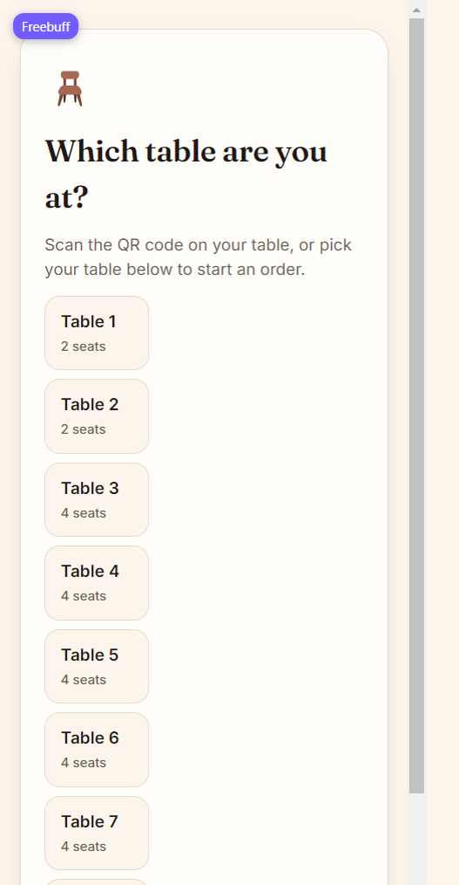
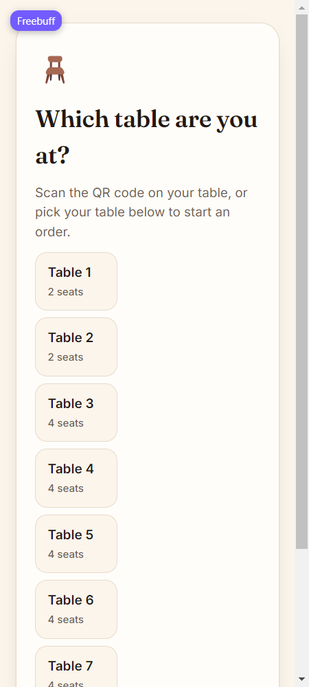
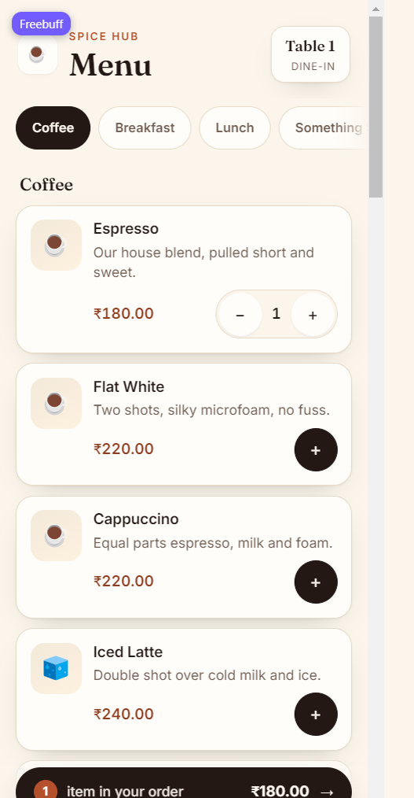
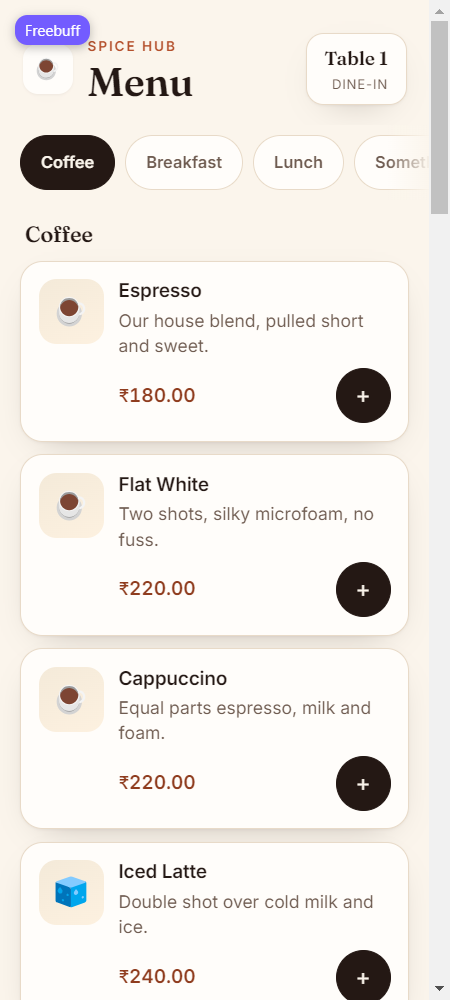
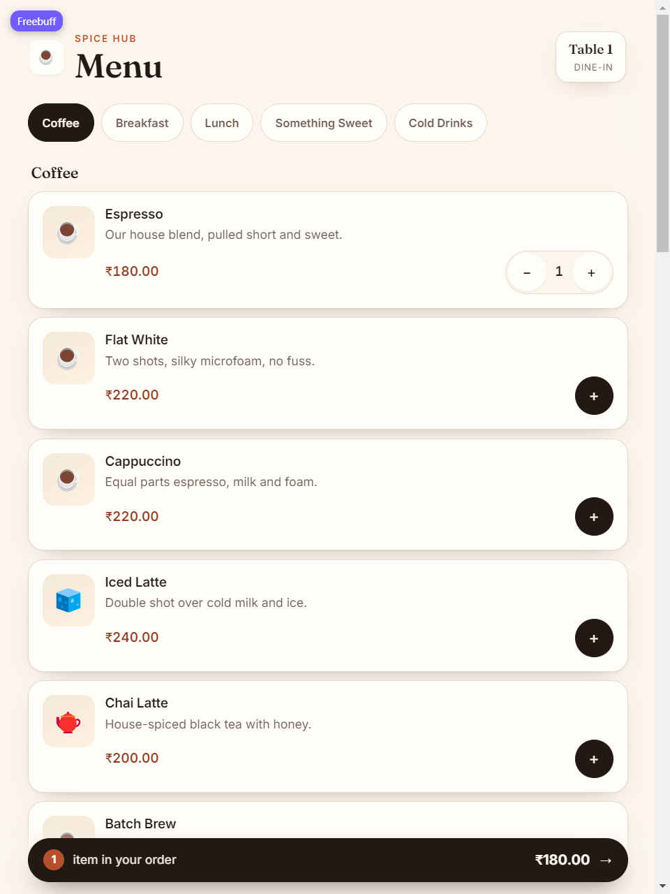
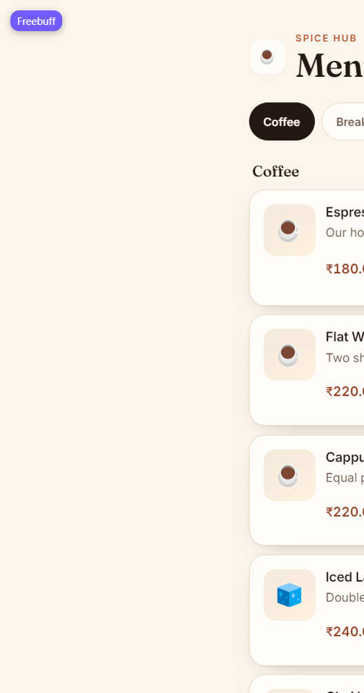
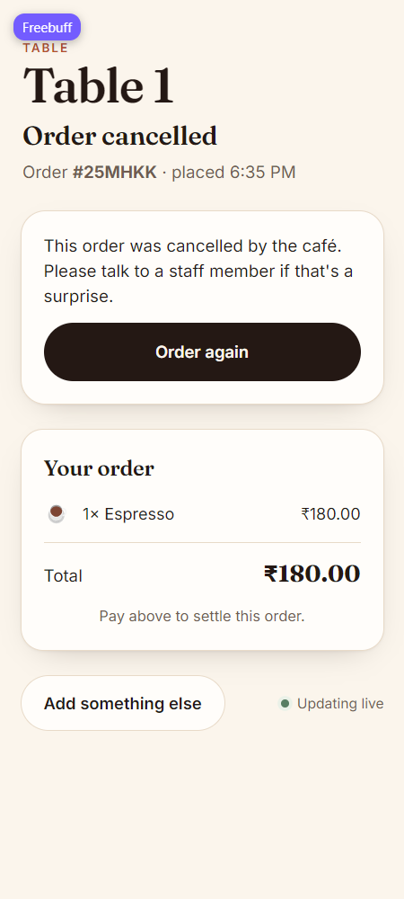
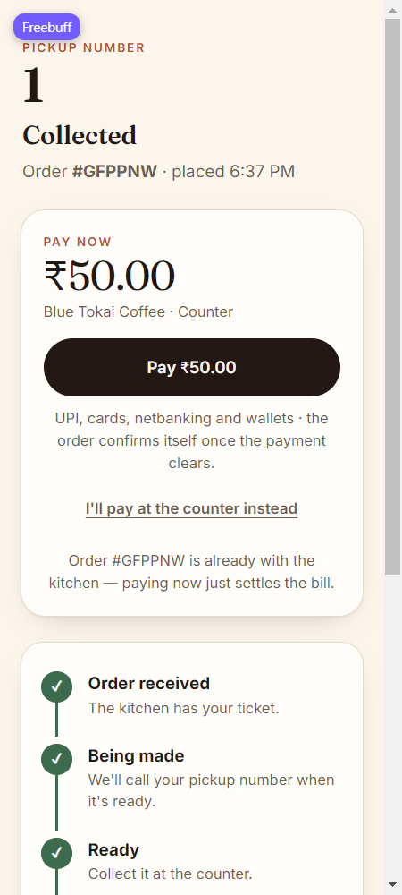
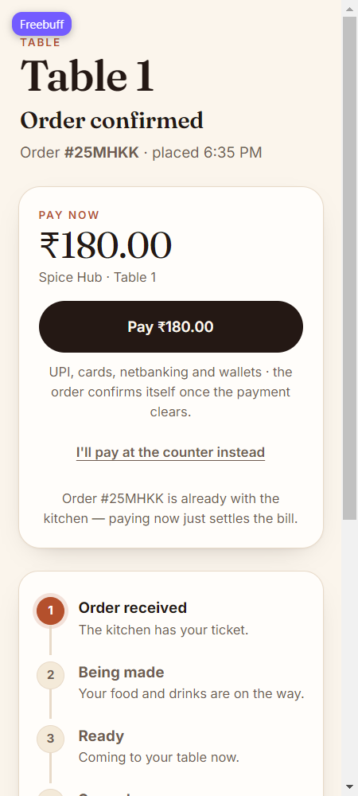

# Corner Cup — Stage 2.1 Visual Regression Review

**Mode:** read-only. No source file, test file, database, payment setting or deployment was changed. Nothing staged or committed. The local server used for the review has been stopped.

**Verdict:** the Stage 2 implementation holds up in table-service mode, at every tested width, and the keyboard dialog behaviour is correct. Two real issues were found — neither introduced by Stage 2 — plus three limitations of the verification harness itself. Details in §7.

---

## 1. How the table-service environment was isolated

Both cafés in the local dev database run `service_mode = counter`, so table mode could not be exercised without a fixture. The whole local state directory was **copied** to a new one and only the copy was changed:

| Step | Command effect |
|---|---|
| Copy | `.wrangler/state` → `.wrangler/stage2-1-tables` (new directory) |
| Configure | `UPDATE cafes SET service_mode='tables' WHERE slug='corner-cup-caf'` **in the copy only** |
| Serve | `wrangler dev --persist-to .wrangler/stage2-1-tables --port 3001` |

Afterwards, the original local database still reports `corner-cup-caf|counter` and `blue-tokai|counter`, and `.wrangler/state` was never written to. No production or staging environment was contacted; both Sites environments remain unpublished and untouched since Stage 15.

Two local fixture orders were created in the isolated copy (§6). The copied database already contained 28 pre-existing orders, which were left alone apart from the two fixture rows.

---

## 2. Table picker — 360px and 390px



| Check | 360px | 390px |
|---|---|---|
| Heading | "Which table are you at?" | same |
| Table chips | 8 | 8 |
| Chip size | 96×68 | 96×68 |
| Targets under 44px | 0 | 0 |
| Horizontal overflow | none (`scrollWidth` 343) | none |
| Error banners | 0 | 0 |

**Issue found (pre-existing, not from Stage 2):** the picker renders as a single column of eight 96px chips inside a 338px card. Measured: `.state-card` sets `justify-items: start`, so the `.table-grid` shrinks to its first column — `gridWidth` 96px, `grid-template-columns` resolves to `96px` — instead of using the card width for the 2–3 column grid its CSS declares. The defect is in base CSS that Stage 2 did not touch, but it is the most visible remaining problem in table mode. A one-line fix (`.state-card .table-grid { justify-self: stretch }`) would be needed; it was **not** applied, as this stage is read-only.



---

## 3. Table menu, cart and checkout

| Check | 360px | 390px |
|---|---|---|
| Badge | "Table 1 / Dine-in" | "Table 1 / Dine-in" |
| Heading | "Menu" | "Menu" |
| Active category | Coffee | Coffee |
| Horizontal overflow | none (`scrollWidth` 343) | none (`scrollWidth` 374) |
| Targets under 44px | 0 | 0 |
| Price / stepper collision | none | none |




**Checkout** was exercised end-to-end at 360px: cart bar → sheet → `Send order & pay` → `POST /api/cafes/corner-cup-caf/orders` → redirected to `/c/corner-cup-caf/t/1/order/25MHKK#t=…` with heading "Order confirmed". The cart sheet at 390px is captured in `review-07-cart-390.png`; the footer order is helper copy → total → primary action, with "Add more items" after it, so `.sheet-foot button` still resolves to the send button.

---

## 4. Tablet and desktop

| Width | Page width | Overflow | Rail | Notes |
|---|---|---|---|---|
| 768×1024 | 720 | none | all 5 chips fit | single column, price left / control right |
| 1280×900 | 720 | none | all 5 chips fit | cart bar 688, page centred |




**Harness limitation:** the 1280px capture is cropped to the left ~531px by the screenshot tool, so the image shows the page's left edge only. The layout itself was verified by measurement (no overflow, 720px page, 688px cart bar) rather than by eye. The 768px capture came out complete.

---

## 5. The cart sheet's 2px horizontal overhang — actual cause

Measured at 360px, sheet open, one line at quantity 1:

| Quantity | Value |
|---|---|
| Viewport | 360 |
| `.sheet` border-box width | **343.2px** (360 − 16.8px classic scrollbar, at `devicePixelRatio` 1.25) |
| `.sheet-body` padding | `4px 20px` |
| Available content width | **303.2px** |
| `.sheet-body` display | `grid`, **no `grid-template-columns`** |
| Resolved implicit track | **304.612px** |
| `clientWidth` / `scrollWidth` | 343 / **345** |

**Cause.** `.sheet-body` is a grid with no explicit column, so its implicit `auto` track is sized to its items' **max-content** contribution. The widest item is the cart row, whose max-content is:

`emoji 27.46 + text 65.55 + stepper 123.60 + price 58.00 + 3 × 10px gaps = 304.61px`

That is **1.41px wider than the 303.2px content box**, so the track overflows by 1.41px. `scrollWidth` reports 345 because it adds the 20px right padding to the row's 324.61px right edge. At 390px the same sheet has 333.6px of content width — more than the 304.61px max-content — and the overhang measures **0**, which confirms max-content sizing rather than a border or scrollbar rounding.

**Does the clipping hide anything?** No.

- Widest child right edge: **324.61px**; `.sheet-body` visible right edge: **343.2px** → everything sits **18.6px inside** the clip.
- `overflow-x: hidden` clips at the padding box, not the content box, so even the 1.41px track excursion is not visible.
- Elements whose box crosses the sheet's right edge: **0**, at both 360 and 390. `clippedInteractive` (buttons/textarea past the edge): **0**.
- The price text, the stepper buttons and the textarea all render fully; the visible scrollbar that existed before the Stage 2 `overflow-x: hidden` had nothing meaningful to scroll.

**Correct fix, not applied:** give the grid an explicit column (`grid-template-columns: minmax(0, 1fr)` on `.sheet-body`) or `min-width: 0` on `.sheet-line`. Cosmetic either way — the amount is 1.4 CSS px and no content is lost.

---

## 6. Order tracking across all statuses

Fixtures: one table order and one pickup order created through the normal UI against the isolated database, then moved through statuses with direct `UPDATE orders SET status=…` on that **isolated copy**. No production or staging order was created; the production database was not contacted.

| Status | Mode | Heading | Queue element | Eyebrow | Timeline |
|---|---|---|---|---|---|
| `new` | table | **Order confirmed** | Table 1 | Table | active / todo ×3 |
| `preparing` | table | **Being made** | Table 1 | Table | done / active / todo ×2 |
| `ready` | table | **Your order is ready** | Table 1 | Table | done ×2 / active / todo |
| `served` | table | **Served** | Table 1 | Table | done ×3 / active |
| `cancelled` | table | **Order cancelled** | Table 1 | Table | none (no timeline rendered) |
| `ready` | pickup | **Ready to collect** | 1 | Pickup number | detail: "Collect it at the counter." |
| `served` | pickup | **Collected** | 1 | Pickup number | detail: "Enjoy — see you again soon." |

Queue-number prominence measured on the pickup order at 360px: **46.8px** display type against a **23.2px** heading — the number is the largest text on the page.





**Issue found (pre-existing):** a cancelled order still shows a receipt footer reading "Pay above to settle this order." with the full total, even though the order was cancelled and there is nothing to pay. The payment summary logic in `OrderStatus.jsx` has no `cancelled` branch; it is untouched by Stage 2 and outside the "no payment changes" boundary, so it was left as found and is recorded here.

---

## 7. Keyboard accessibility and dialog semantics

**Semantics (measured):** `role="dialog"`, `aria-modal="true"`, `aria-labelledby="cart-sheet-title"`, and that id resolves to visible text ("Table 1"), so the accessible name is real rather than missing. Six tabbables in DOM order: Close → Remove one → Add one → textarea → Send order & pay → Add more items. Focus lands on the close control when the sheet opens, with a visible focus ring (computed `outline: solid`, 2px at dpr 1.25).

**Behaviour (measured by dispatching the same `KeyboardEvent`s the component listens for):**

| Action | Result |
|---|---|
| `Tab` on the last control ("Add more items") | prevented, focus wraps to **Close order** |
| `Shift+Tab` on the first control ("Close order") | prevented, focus wraps to **Add more items** |
| `Escape` while open | sheet closes, `body.sheet-open` removed, focus restored to **`.cart-bar`** |
| Focus while open | never leaves the dialog (both wrap directions stay inside) |

**Harness limitation, stated plainly:** this preview tab reports `document.visibilityState === "hidden"` and initially `document.hasFocus() === false`. A native `Tab` press *was* delivered (focus moved to the close button), but native `Shift+Tab` and `Escape` presses were not, so those two were proven with dispatched keyboard events rather than physical keys. In Stage 2 the same `Tab`/`Escape` pair was verified with real key presses while the tab had focus; nothing in the component changed since. Native `Shift+Tab` traversal therefore remains **not** verified in this stage, only the handler logic that intercepts it.

**Screen-reader notes:** the dialog has a valid accessible name and `aria-modal`; the surrounding page is not marked `inert`/`aria-hidden`, so the trap enforces containment by keyboard but assistive-technology traversal of the background is left to `aria-modal` support. That is unchanged from Stage 2 and worth a follow-up if a screen-reader pass is required.

---

## 8. Test contracts and test run

Both original contracts are untouched in the test source and still resolve in the live DOM:

```
tests/menu.component.test.mjs:399  const bar = page.container.querySelector(".cart-bar");
tests/menu.component.test.mjs:402  const place = page.container.querySelector(".sheet-foot button");
```

`.cart-bar` exists on the menu with a quantity, and `.sheet-foot button` resolves to the send button, because "Add more items" is rendered **after** it.

```
node --import ./tests/setup/register.mjs --test \
  tests/menu.component.test.mjs tests/orderstatus.component.test.mjs tests/orderstatus.status.test.mjs
→ tests 18, pass 18, fail 0, exit 0
```

No assertion was modified, weakened or skipped; no test file was edited.

---

## 9. Remaining issues

| # | Issue | Severity | Source |
|---|---|---|---|
| 1 | Table picker collapses to one 96px column (`justify-items: start` on `.state-card` shrinking `.table-grid`), so eight tables stack vertically on a 390px phone | **Medium** — most visible table-mode defect | Pre-existing base CSS, untouched by Stage 2 |
| 2 | Cancelled order's receipt still says "Pay above to settle this order." | Low — misleading copy | Pre-existing payment-summary logic |
| 3 | `.sheet-body` implicit grid track is 1.41px wider than its content box at 360px (2px `scrollWidth` overhang); clipped, hides nothing | Cosmetic | Pre-existing grid layout, contained by Stage 2's `overflow-x: hidden` |
| 4 | Physical `Shift+Tab` / `Escape` not deliverable in this preview tab; handler verified by dispatched events only | Verification gap, not a defect | Harness |
| 5 | 1280px screenshot cropped by the capture tool to ~531px | Verification gap | Harness |
| 6 | Razorpay `theme.color` still `#231713` rather than `--ink` | Cosmetic inconsistency | Deliberate: payment configuration out of bounds |
| 7 | Duplicate CSS blocks (`.landing`, `.table-chip`, `.landing-note`, `.site-foot-links a`) remain | Debt | Deliberate deferral from Stage 2 |
| 8 | Dialog background is not `inert`; containment relies on the focus trap plus `aria-modal` | Low | Design of Stage 2 sheet |

Nothing was fixed in this stage: it is a review, and every edit is prohibited.

---

## 10. Artifacts produced

`UI_IMPROVEMENT_STAGE2_1_REVIEW.md` and the following screenshots, all under `ui-audit/`:

| File | Content |
|---|---|
| `review-01-table-picker-360.png` | table picker, 360 |
| `review-02-table-menu-360.png` | table menu, 360 |
| `review-03-status-new-360.png` | table order, new |
| `review-04-status-cancelled-360.png` | table order, cancelled |
| `review-05-status-collected-360.png` | pickup order, collected |
| `review-06-table-menu-390.png` | table menu, 390 |
| `review-07-cart-390.png` | cart sheet, 390 |
| `review-08-table-menu-768.png` | table menu, 768 |
| `review-09-table-menu-1280.png` | table menu, 1280 (cropped by tool) |
| `review-10-table-picker-390.png` | earlier capture of the table menu at 390 (superseded) |
| `review-11-table-picker-390.png` | table picker, 390 |

The isolated fixture environment remains at `.wrangler/stage2-1-tables` for reproducibility; it contains the two fixture orders and is not used by the app or the tests.
