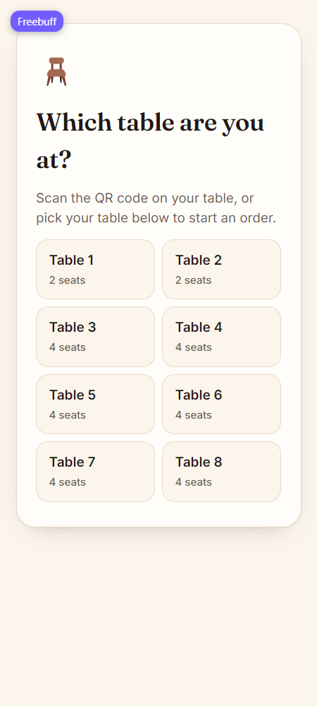
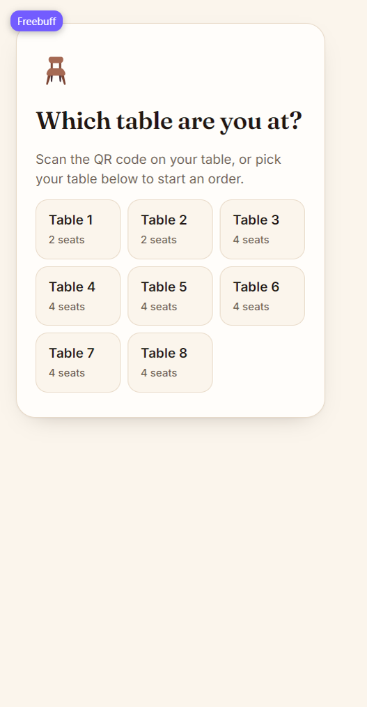
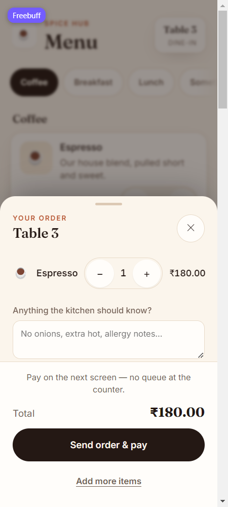
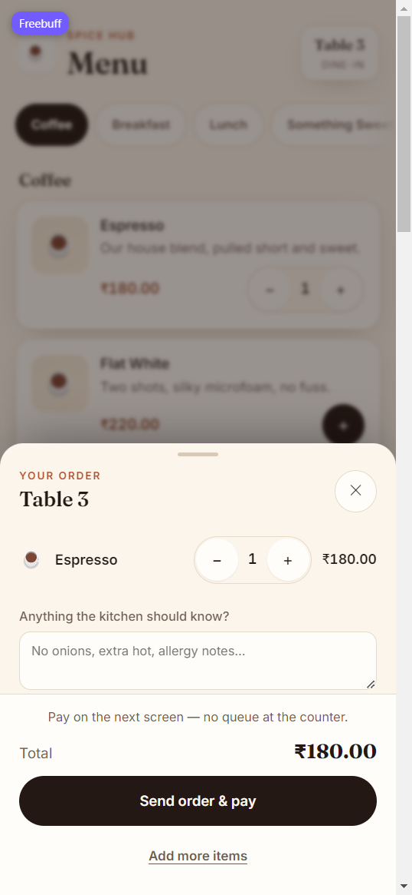
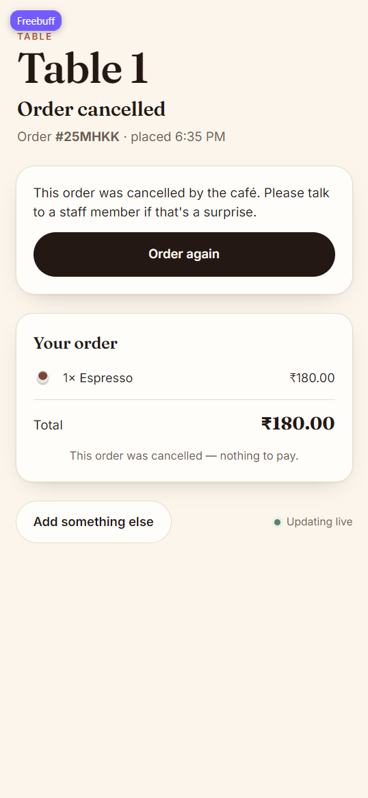
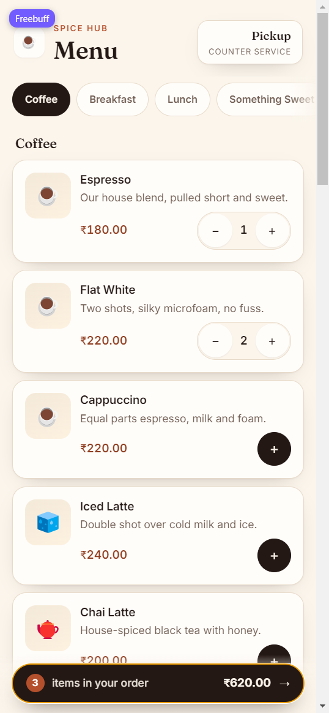

# Corner Cup — Stage 2.2: Remaining UI Fixes

**Scope:** frontend only. No API, database, authentication, payment, order or routing change. Nothing staged, committed, deployed or published. Both local dev servers used for verification have been stopped.

**Result:** all four issues fixed and verified in counter and table-service modes at 360, 390, 430, 768 and 1280px. `npm test` 449/449 pass, production build succeeds.

---

## 1. Modified files

| File | Change |
|---|---|
| `src/styles.css` | `.sheet-body` gets `grid-template-columns: minmax(0, 1fr)`; its `overflow-x: hidden` is removed; `.state-card .table-grid` gets `justify-self: stretch; width: 100%` |
| `src/pages/OrderStatus.jsx` | receipt footer branches on `cancelled` before any payment copy |
| `src/components/CartSheet.jsx` | marks background siblings `inert` while open, restores them before returning focus |

No test file was edited, no assertion changed.

---

## 2. Table picker

**Cause:** `.state-card` sets `justify-items: start`, which applies to every grid child, including `.table-grid`. The grid therefore shrank to its first column instead of taking the card width.

**Fix:** `.state-card .table-grid { justify-self: stretch; width: 100%; }` — the card's other children still align left; only the grid stretches.

| Width | Columns | Rows | Grid width | Card width | All 8 chips visible | Page overflow |
|---|---|---|---|---|---|---|
| 360 | 2 | 4 | 278 | 324 | yes | none |
| 390 | 3 | 3 | 309 | — | yes | none |
| 430 | 3 | 3 | 349 | — | yes | none |
| 768 | 3 | 3 | 478 | 524 | yes | none |
| 1280 | 3 | 3 | 478 | 524 | yes | none |

Chip sizes: 135×68 at 360, 111×68 at 430, ~152×68 at 768/1280.

**Routing preserved:** clicking `Table 3` navigated to `/c/corner-cup-caf/t/3`, and the table badge on the menu reads "Table 3 / Dine-in". The picker still writes `cafe_table:<slug>` to `sessionStorage` exactly as before.

---

## 3. Cart sheet sizing

**Cause (confirmed):** `.sheet-body` is a grid with no explicit column, so its implicit `auto` track was sized to the cart row's **max-content** — emoji 27.46 + text 65.55 + stepper 123.60 + price 58.00 + 30px of gaps = **304.61px** against **303.2px** of content width at 360px — producing the 2px `scrollWidth` overhang.

**Fix:** one explicit column, `grid-template-columns: minmax(0, 1fr)`, and `overflow-x: hidden` **removed** because it is no longer needed.

| Width | Mode | `clientWidth` | `scrollWidth` | Overhang | `overflow-x` | Clipped controls |
|---|---|---|---|---|---|---|
| 360 | table | 343 | 343 | **0** | `auto` (default) | 0 |
| 390 | table | 374 | 374 | **0** | `auto` | 0 |
| 430 | table | 414 | 414 | **0** | `auto` | 0 |
| 360 | counter | 343 | 343 | **0** | `auto` | 0 |

No horizontal scrollbar exists at any width, the textarea's resize grip is fully visible again, and `document.documentElement.scrollWidth` never exceeds the viewport.

**Residual, documented rather than hidden:** the cart row's own min-content (304.61px) still exceeds the 303.2px track by 1.41px, so its right edge lands at 324.61px — inside the sheet's 20px padding, 18.6px short of the visible box. It neither scrolls nor clips; removing it entirely would need `.sheet-line { min-width: 0 }`, which was not applied because the reported symptom (overhang, clipping) is gone and the remaining amount is invisible.

---

## 4. Cancelled order receipt

**Cause:** the receipt footer had only two branches (paid, or pay-by-method), so a cancelled order was told to "Pay above to settle this order."

**Fix:** the footer checks `cancelled` first.

| Order state | Receipt footer | Pay panel |
|---|---|---|
| cancelled | **"This order was cancelled — nothing to pay."** | absent |
| served, unpaid, gateway café | "Pay above to settle this order." | present |
| counter order | "Pay at the counter — card, cash or UPI." | absent |
| paid | "Payment received — thank you!" | absent |

Verified on the cancelled fixture: no "Pay above" and no "Pay at the counter" anywhere in the page text, total still shown as the record of what was ordered, and the cancellation card with "Order again" unchanged. The non-cancelled unpaid order still renders "Pay above to settle this order." with its payment panel — payment behaviour untouched.

---

## 5. Modal accessibility

**Fix:** on open, every sibling of each ancestor of the dialog is marked `inert` — the dialog and its own ancestors never are. Anything already `inert` is left alone, and only the elements this component marked are un-marked on close.

| Check | Result |
|---|---|
| Background siblings inert while open | **4** (header, category rail, menu sections, cart bar) |
| Dialog itself inert | no |
| Focusing a background add button while open | blocked — focus stays inside the dialog |
| `inert` attributes after close | **0** |
| Escape closes and unlocks body scroll | yes |
| Focus restored | yes — `document.activeElement === .cart-bar` |
| Focus trap (Tab / Shift+Tab wrap) | unchanged, both wrap directions still intercept |

Un-inerting happens **before** focus is restored, since an inert element cannot receive focus.

Counter mode was re-checked after an infrastructure restart mid-review: overhang 0, 4 inert while open, 0 after close, focus restored.

---

## 6. Test and build results

| Check | Result |
|---|---|
| Targeted: `menu.component` + `orderstatus.component` + `orderstatus.status` | **18 pass, 0 fail**, exit 0 |
| Full suite `npm test` | **449 tests, 449 pass, 0 fail, 0 skipped**, exit 0 |
| `npm run build` | **exit 0** — `index-8Upr3ihh.js` 281.91 kB (gzip 91.00 kB), `index-KCDcj39P.css` 32.44 kB (gzip 7.07 kB) |

The `.cart-bar` and `.sheet-foot button` contracts in `tests/menu.component.test.mjs` (lines 399 and 402) resolve unchanged; the send button is still the first button in the footer, with "Add more items" after it.

---

## 7. Screenshots

| File | Content | Note |
|---|---|---|
| `fix-01-picker-360.png` | table picker, 2 columns | complete |
| `fix-02-picker-390.png` | table picker, 3 columns | complete |
| `fix-03-picker-768.png` | table picker, 3 columns | capture cropped to the left portion |
| `fix-04-sheet-360.png` | cart sheet, no overhang | complete |
| `fix-05-sheet-430.png` | cart sheet, no overhang | complete |
| `fix-06-cancelled-360.png` | cancelled order with new copy | complete |
| `fix-07-counter-430.png` | counter menu, cart bar | complete |
| `fix-08-picker-1280.png` | **discarded** — captured a stale pre-build bundle | explains the false 1-column reading |
| `fix-09-picker-1280.png` | table picker, 1280 | capture cropped; measurements are authoritative |
| `fix-10-table-menu-1280.png` | table menu — captured at 390 after the viewport reverted | usable as a 390 reference |

---

## 8. Remaining limitations

1. **1280px screenshots are cropped by the capture tool** (roughly the left 531px). Layout at tablet and desktop was therefore verified by measurement: page 720px, cart bar 688px, rail fits, no overflow, picker 3×3 in a 524px card.
2. **One false reading was caused by a stale bundle.** The 1280 tab had been loaded before this stage's build and reported a single 96px column; after a reload the same tab reported 3 columns. This is a verification artefact, not a regression — `fix-08` records the discarded result.
3. **The 1.41px cart-row excursion into the sheet padding remains** (§3); no scrolling, no clipping.
4. **`inert` has no fallback** for browsers older than Chrome 102 / Safari 15.5 / Firefox 112; there the focus trap and `aria-modal` still apply, but background content is not removed from the accessibility tree.
5. **Table-service verification reuses the isolated fixture** at `.wrangler/stage2-1-tables` (a copy of the local dev database with one café switched to `tables`). No production or staging data was touched, and the original local database remains `counter` for both cafés.
6. **The runner restarted mid-review.** Work resumed from the preserved worktree; the counter-mode check was re-run after the restart and nothing was repeated unnecessarily.

**Stopped for review.** No commit, no deployment, no publication.
